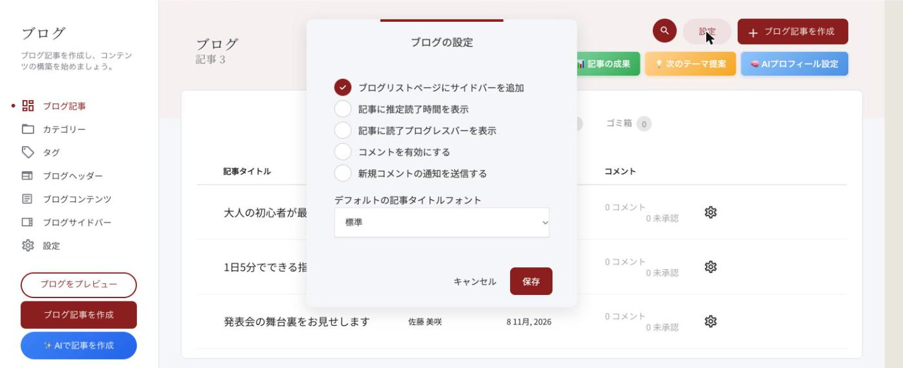
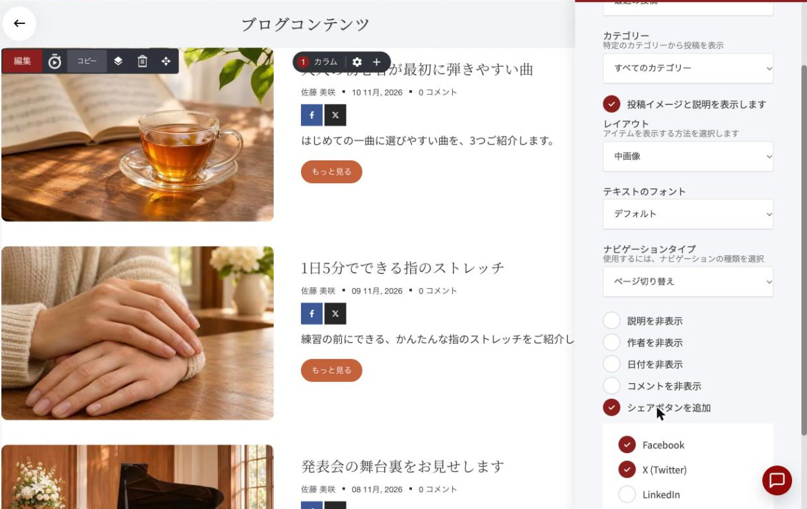
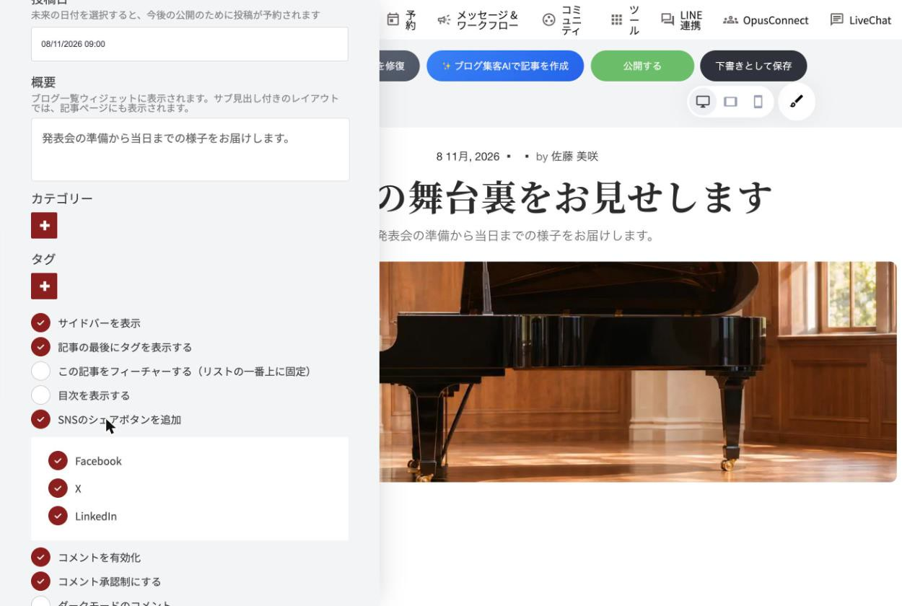

# ブログ設定

ブログ全体の設定を変更するには、ブログ記事の一覧画面で右上の［設定］をクリックします。左メニューの［設定］からも、同じ画面が開きます。

<figure><figcaption>
右上の［設定］を押すと開く「ブログの設定」
</figcaption></figure>

この画面では、次のことができます。

| 項目 | 内容 |
| --- | --- |
| ブログリストページにサイドバーを追加 | 記事一覧の横にサイドバーを表示します |
| 記事に推定読了時間を表示 | 「読了まで約◯分」を記事に表示します |
| 記事に読了プログレスバーを表示 | 読み進めた割合を示すバーを画面に表示します |
| コメントを有効にする | 読者がコメントを投稿できるようになります |
| 新規コメントの通知を送信する | コメントが届いたときにお知らせを受け取ります |
| デフォルトの記事タイトルフォント | 記事タイトルに使うフォントを選びます |

設定を変えたら、［保存］を押してください。


**サイドバーを作ったのに、記事一覧に出ないときは**\
いちばん上の「ブログリストページにサイドバーを追加」にチェックが入っているか確かめてください。ここにチェックが無いと、[サイドバーを編集](blog-header-and-sidebar-settings.md)して保存しても、記事一覧のページには表示されません。



**推定読了時間と読了プログレスバーについて**\
どちらも「この記事はどれくらいで読み終わるか」を読者に伝える機能です。長めの記事を書く方は、離脱を防ぐ効果が期待できます。まずはどちらか一方から試してみてください。


## SNSのシェアボタンを出す・消す 

Facebook や X のシェアボタンは、上の「ブログの設定」の画面では**なく**、次の2か所で決めます。出る場所が違うので、目的に合うほうを設定してください。

| 設定する場所 | ボタンが出る場所 |
| --- | --- |
| ブログコンテンツのブログウィジェット | **記事一覧**のページ（各記事の日付の下） |
| 記事ごとのブログ設定 | **その記事**のページ（題名の下） |

### 記事一覧のページに出す・消す

1. ブログの管理画面の左メニューで［ブログコンテンツ］を開きます
2. 記事が並んでいる部分をクリックして選び、左上に出る［編集］を押します
3. 右に開く設定を下へスクロールし、「シェアボタンを追加」のチェックを入れる（または外す）
4. チェックを入れると、Facebook・X (Twitter)・LinkedIn の3つが出ます。使うものだけにチェックを入れます
5. 設定の外側（ページの空いているところ）をクリックして設定を閉じ、右上の［保存］を押します

<figure><figcaption>
「シェアボタンを追加」にチェックを入れると、記事一覧の各記事にボタンが出ます
</figcaption></figure>


最初は「シェアボタンを追加」にチェックが入っていて、Facebook と X (Twitter) のボタンが出る状態になっています。記事一覧をすっきり見せたいときは、チェックを外して保存してください。


### 記事のページに出す・消す

記事を開いたページにシェアボタンを出すかどうかは、記事ごとに決めます。

1. ブログ記事の一覧で、記事のタイトルをクリックして編集画面を開きます
2. 左上の歯車のアイコンを押して「ブログ設定」を開き、［ブログ情報］のタブを下へスクロールします
3. 「SNSのシェアボタンを追加」にチェックを入れる（または外す）
4. チェックを入れると、Facebook・X・LinkedIn の3つが出ます。使うものだけにチェックを入れます
5. ［公開する］を押して保存します

<figure><figcaption>
記事ごとの「ブログ設定」→［ブログ情報］にある「SNSのシェアボタンを追加」
</figcaption></figure>

チェックを入れて公開すると、その記事のページの題名の下に、シェアボタンが横に並んで表示されます。記事一覧のページや、ほかの記事には影響しません。


記事ごとの「SNSのシェアボタンを追加」は、最初はチェックが入っていません。シェアしてほしい記事だけに付ける、という使い方ができます。


***


**自分の場合はどう使えばいいか**

[ブログ集客AIの全体像](https://opusbooster.com/blog-ai)を見る。設計から相談したい方は[15分の無料相談](https://opusbooster.com/consultation)、まず触ってみたい方は[14日間の無料トライアル](https://opusbooster.com/register)（クレジットカード不要）から。

