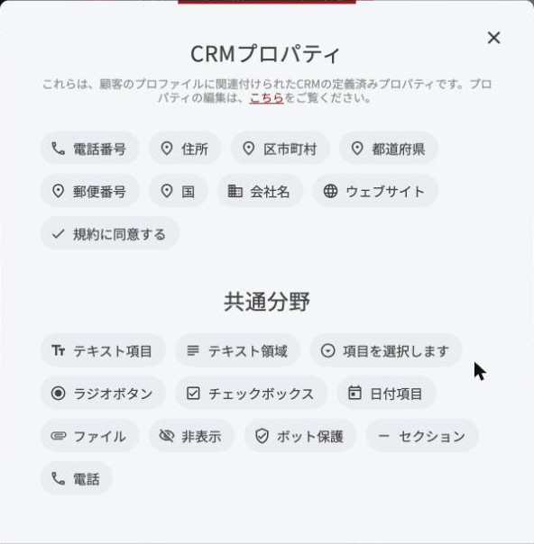
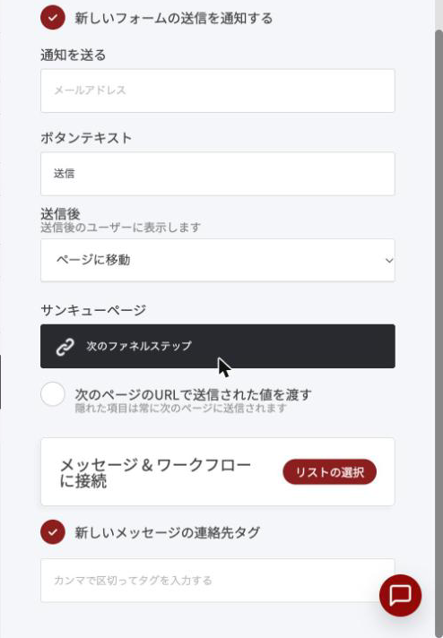
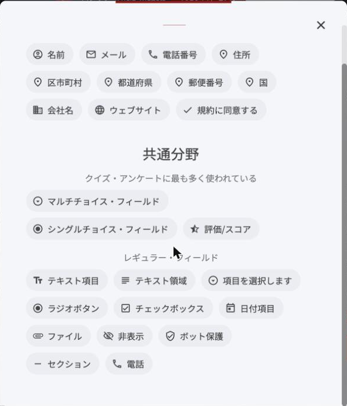
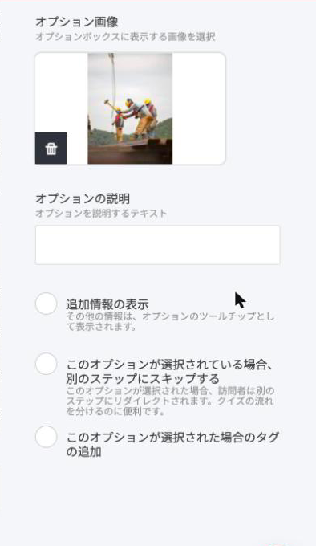

# アスクキャンペーンファネル


アスクキャンペーンのもとになっているのは、マーケター Ryan Levesque(ライアン・レヴェスク)が開発した「ASKメソッド」です。市場に質問を投げかけて、人が本当に求めているものを理解します。この記事で扱うのは、Russell Brunson(ラッセル・ブランソン)が著書『Expert Secrets』で紹介している、1問だけで始められる簡易版です。


### アスクキャンペーンファネルとは？

アスクキャンペーンファネルは、見込み客に質問を1つだけ投げかけ、その回答と連絡先を受け取る2ページのファネルです。

講座や教材を作るとき、作り手は「これが必要なはずだ」と考えた中身を並べがちです。ところが、相手が実際に知りたいことは、作り手の想像とずれていることがよくあります。ずれたまま作ると、良い内容でも申し込みにつながりません。

このファネルでは、作る前に聞きます。集まった回答から、次の3つが分かります。

- **何を知りたがっているか** – 講座の章立てや、教材の目次になります。
- **どんな言葉で悩みを語るか** – 告知文や見出しに、そのまま使えます。
- **誰が答えているか** – 想定していた相手と、実際に関心を持つ相手が違うことがあります。

回答してくれた人は、そのテーマに関心があると自分から手を挙げた人でもあります。講座ができたときに、最初に案内する相手になります。

### こんな場面で使えます

- **新しい講座を作る前** – ピアノ教室の先生が「大人の初心者向け講座」を作る前に、何につまずいているかを聞く。
- **体験レッスンの中身を決めるとき** – 入会を迷っている人が、何を不安に思っているかを聞く。
- **ウェビナーやイベントの前** – 申し込んだ人に、当日いちばん聞きたいことを聞く。
- **既存の生徒さん・お客様へ** – 次に作ってほしい教材やレッスンを聞く。

事業の段階を問わず使えます。新しい企画を立てるときや、手応えが止まったと感じたときに、年に数回くり返すのがおすすめです。

### ファネル概要

このファネルは、次の2ステップで構成されます。

1. 質問ページ
2. サンキューページ

OpusBoosterでは、同じ2ステップの[リードジェネレーション](lead-generation.md)のテンプレートを土台にすると、そのまま組めます。違いは、フォームに「質問への回答」の欄を1つ足すことだけです。

### 質問を決める

このファネルの成果は、質問の文面でほぼ決まります。型は次のひとつです。

> 〇〇について、いちばん知りたいこと(困っていること)は何ですか？

〇〇に入れるテーマは、**狭く具体的に**します。

| 質問 | 結果 |
| --- | --- |
| 音楽について、いちばん知りたいことは？ | 広すぎて答えにくく、回答が集まらない |
| ピアノの練習について、いちばん困っていることは？ | 答えは出るが、内容がばらつく |
| 大人になってピアノを始めた方へ。両手で弾く練習で、いちばん困っていることは？ | 答えやすく、そのまま講座の中身になる |

聞くのは1問だけにします。2問、3問と増やすと、答える前に閉じる人が増えます。


「どんな講座が欲しいですか」「いくらなら申し込みますか」とは聞きません。欲しいものや払える金額は、聞かれた本人にも分からないからです。聞くのは、いま困っていることのほうです。


### 質問ページ

質問ページは短くてかまいません。上から順に、次の5つを置きます。

1. **名乗る** – 自分が誰で、何をしている人かを一文で。
2. **お願いする** – 「アドバイスをいただけませんか」と、相手に頼る形で切り出します。
3. **理由を伝える** – いま何を作っていて、なぜ意見が必要なのか。「大事なことを抜かしたくない」と正直に書きます。
4. **質問する** – 上で決めた1問。「こんなことを聞いていいのかな、と思うことでも大丈夫です」と添えると、答えやすくなります。
5. **お礼を約束する** – 答えてくれた方に渡すものを伝えます。

お礼は、完成した講座への無料招待、先行案内、質問に答える無料の勉強会などが向いています。聞いたテーマと同じ中身であることが条件です。関係のない特典を付けると、テーマに関心のない人の回答が混ざります。


売り込みのページではないので、凝ったデザインは要りません。手紙のように、自分の言葉で書いたほうが回答が集まります。


### 回答を受け取る(フォームウィジェット)

1問だけを聞くなら、[フォームウィジェット](../../platform/widgets/form-widget.md)で受け取るのがいちばん簡単です。

**1. 回答の欄を用意する**

回答には、複数行で書ける「テキスト領域」の項目を使います。フォームウィジェットには、最初から「メッセージ」という名前のテキスト領域が入っているので、これを質問の欄として使えます。新しく足す場合は、「フィールドを編集」から「項目を追加」を押し、「テキスト領域」を選びます。

<figure><figcaption>
「項目を追加」で選べる項目。複数行の回答には「テキスト領域」を使います。
</figcaption></figure>

お名前とメールアドレスは必須にします。「件名」など、使わない項目は消しておきます。

**2. 回答を連絡先に残す**

項目の歯車を押すと、「**CRM プロパティへマッピング**」という設定があります。ここで保存先の項目を選ぶと、回答が連絡先ごとに残ります。一覧に合う項目が無いときは、最後にある「新しいCRMプロパティとして定義する」を選びます。


連絡先の項目の形式には、複数行のテキストがありません([プロパティ](../../platform/crm/properties.md)で選べるのは「1行のテキスト」などの7種類です)。長い回答を読み返したいときは、次の「新しいフォームの送信を通知する」をオンにして、回答が届いたことをメールでも受け取れるようにしておきます。


**3. フォーム設定を確かめる**

- 「**新しいフォームの送信を通知する**」をオンにし、通知先のメールアドレスを入れる
- 「**送信後**」を「ページに移動」にし、「サンキューページ」を「次のファネルステップ」にする
- 「**メッセージ＆ワークフローに接続**」の「リストの選択」で、リストにつなぐ
- 「**新しいメッセージの連絡先タグ**」にチェックを入れ、タグを入力する(例: アスク_両手の練習)

<figure><figcaption>
フォーム設定。送信後の行き先、リストへの接続、タグをここで決めます。
</figcaption></figure>


フォームをリストにつないでいないと、回答は届いても、お礼のメールやその後の案内は送られません。案内を始める前に自分で回答して、1通目が届くところまで確かめてください。


### クイズ＆アンケートウィジェットで聞く

[クイズ＆アンケートウィジェット](../../platform/widgets/quiz-survey-widget.md)でも、同じことができます。選択式の質問に加えて、「テキスト項目」(1行)や「テキスト領域」(複数行)の自由記入の欄も足せるので、「まず選んでもらい、最後に一言書いてもらう」という組み合わせができます。

<figure><figcaption>
クイズの「項目を追加」。選択式のほかに、自由記入の「テキスト項目」「テキスト領域」も選べます。
</figcaption></figure>

| | フォーム | クイズ |
| --- | --- | --- |
| 向いている場面 | 1問だけを、いちばん少ない手数で聞く | 選択式と自由記入を組み合わせる。答えによって案内を分ける |
| 手に入るもの | 相手の言葉そのもの | 人数の内訳と、相手の言葉 |
| 答える手間 | 文章を書く | 押して進み、最後に書く |
| その後の案内 | 全員に同じ | 答えごとに分けられる |

選択肢ごとの歯車を押すと、次の設定ができます。

- 「**このオプションが選択された場合のタグの追加**」 – 選んだ答えに応じたタグを付け、案内するメールを分けます。
- 「**このオプションが選択されている場合、別のステップにスキップする**」 – 答えによって、次に聞くことを変えます。

<figure><figcaption>
選択肢1つの設定。タグの追加と、別のステップへのスキップをここで決めます。
</figcaption></figure>

自由記入の欄には、フォームと同じ「CRM プロパティへマッピング」の設定があります。

設定タブの「**オートアドバンス**」をオンにすると、選択肢がタイルで並ぶ単一選択のステップでは、押すだけで次へ進みます。リストへの接続は、同じ設定タブの「メッセージ＆ワークフローに接続」で行います。


はじめての回は、自由記入の欄を必ず入れてください。選択肢は作り手の想像でしか作れないので、選択式だけでは、想像の外にある答えを拾えません。


### サンキューページ

回答のあとに表示するページです。次の3つを伝えます。

- 回答へのお礼
- 約束したお礼を、いつ、どう受け取れるか
- このあと届くメールのこと

勉強会や講座が先の日付なら、日時と、カレンダーに入れてもらうための案内をここに書きます。

### 回答を集める

ページができたら、質問を届けます。届け先は、関係の近い順に3つです。

1. **メールやLINEの読者** – いちばん答えてもらいやすい相手です。本文に質問をそのまま書き、ページへのリンクを添えます。
2. **SNSのフォロワー** – 投稿やライブ配信で同じ質問を投げかけます。
3. **まだ接点のない人** – 同じテーマに関心のある人が集まる場所で、普段からやり取りがある場合に限ります。はじめて顔を出した場所で質問だけ置いていくと、歓迎されません。

期間は数日から1週間ほどに区切ると、「いま答えよう」と思ってもらいやすくなります。

### 集まった回答の使い方

回答が数十件から100件ほど集まったら、似た内容どうしをまとめます。たいていは、6〜8つほどのまとまりに落ち着きます。

- **まとまり1つが、講座の章1つになります。** 件数の多いものから順に並べると、そのまま目次の下書きになります。
- **回答の言い回しを、告知文に使います。** 「左手が止まってしまう」と書かれていたら、案内文にも「左手が止まらなくなる練習」と書きます。作り手の言葉より、相手の言葉のほうが伝わります。
- **答えた人の顔ぶれを見ます。** 本人向けに作るつもりだった講座に、保護者や指導者からの質問が多く届くことがあります。その場合は、誰に向けて作るかから考え直します。

### 回答後の自動メール

フォームやクイズで付けたタグを起点に、[オートメーション](../../platform/email-and-automation/automation.md)でメールを用意しておきます。

| 送る時期 | 内容 |
| --- | --- |
| 回答直後 | お礼、約束したお礼の受け取り方 |
| 受付の締め切り後 | 集まった回答のまとめと、そこから決めた内容の報告 |
| 勉強会・講座の前 | 日時と参加方法の案内 |
| 終了後 | 録画や資料、次の一歩の案内 |

「いただいた声をもとに、こう決めました」という報告は、ぜひ送ってください。答えた人にとっては、自分の意見が形になった知らせになります。

### 公開前の確認

- 質問は1問だけで、テーマは具体的か
- 自分で回答して、サンキューページまで進めたか
- 連絡先のプロフィールに、回答が保存されているか
- 回答直後のメールが届くか
- 約束したお礼を、書いたとおりに渡せるか

---

<!-- cta:opusbooster -->

**自分の場合はどう使えばいいか**

[ファネル機能の全体像](https://opusbooster.com/funnels)を見る。設計から相談したい方は[15分の無料相談](https://opusbooster.com/consultation)、まず触ってみたい方は[14日間の無料トライアル](https://opusbooster.com/register)（クレジットカード不要）から。

