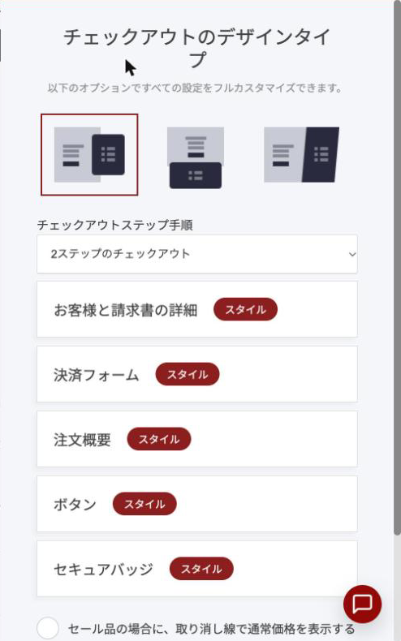
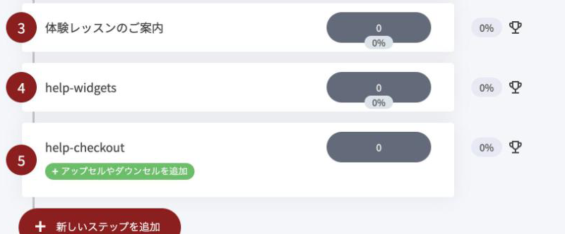

# ブックファネル


ブックファネルは、マーケター Russell Brunson(ラッセル・ブランソン)が自著の販売で広めた型です。バリューラダーの入口にあたり、構成は[トリップワイヤーファネル](tripwire-funnel.md)とほぼ同じです。


### ブックファネルとは？

ブックファネルは、紙の本や電子書籍を低価格(または送料のみ)で届け、その注文の流れの中で関連する商品もあわせて案内するファネルです。

書店やネット書店で本が売れても、著者の手元に残るのは1冊分の利益だけで、誰が買ったのかも分かりません。ブックファネルでは、同じ1冊の注文から次の2つが手に入ります。

- **購入者の連絡先** – 本を読んだあとの案内を、メールで続けられます。
- **1件あたりの売上の上積み** – 注文フォームのついで買いと、購入直後の追加提案が加わります。

本そのもので利益を出すのではなく、本を読む人と出会い、その先の講座やサービスへつなぐための入口として使います。


この型が向いているのは、実用書やノウハウをまとめた本です。小説や詩集のように「読むこと自体が目的」の本は、すでに読者のリストがある場合を除いて、同じ流れでは売れにくいとされています。


### こんな場面で使えます

- **ピアノ教室の先生** – 「大人の初心者が3か月で1曲弾けるようになる練習法」をまとめた小冊子を届け、動画レッスンや体験レッスンへ案内する。
- **演奏家・作曲家** – 楽譜集や教則本を入口に、解説動画つきの講座やオンラインサロンへ案内する。
- **コーチ・講師** – 自分のメソッドをまとめた本を入口に、個別相談や連続講座へ案内する。

### ファネル概要

ブックファネルは、次の4つの要素で構成されます。

1. 本の販売ページ(注文フォームつき)
2. バンプオファー(注文フォーム内のついで買い)
3. アップセル(購入直後の追加提案。1〜2回)
4. サンキューページ

OpusBoosterでは、[トリップワイヤーファネル](tripwire-funnel.md)のテンプレート(ランディングページ → 注文フォーム → OTO 1 → OTO 2 → サンキューページ)を土台にすると、そのまま組めます。販売ページと注文フォームは、1ページにまとめても、2ページに分けてもかまいません。

### 本の販売ページ

販売ページの役割は、本を「買う」のではなく「受け取る」と感じてもらうことです。上から順に、次の3つを並べます。

1. **冒頭** – 読むと何が得られるかを一文で伝える見出しと、本の写真(または短い動画)、注文ボタン。
2. **中ほど** – なぜこの本が必要か、各章で何が分かるか、読んだ人の声。
3. **下部** – 部数や期間の限り、返金の約束、もう一度の注文ボタン。

冒頭で気持ちが動いた人はすぐ注文し、迷う人は中ほどを読んで納得し、それでも迷う人は下部の「今だけ」で決める、という順番です。

本だけを差し出すより、本を注文した人だけが受け取れる特典(PDF版、ワークシート、解説動画など)を添えると、ネット書店で買うのとは違う理由が生まれます。


価格は「無料+送料」でも「本は有料・送料無料」でも、成果に大きな差は出にくいと言われています。自分の本をどう見せたいかで選んでかまいません。どちらの場合も、低単価の範囲に収めるのが基本です。


### 注文フォーム

注文フォームには、[チェックアウトウィジェット](../../platform/widgets/checkout-widget.md)を使います。ブックファネルでは、次の3点を設定します。

**1. チェックアウトを2ステップにする**

チェックアウトウィジェットのスタイリングにある「**チェックアウトステップ手順**」で、「2ステップのチェックアウト」を選びます(最初からこれが選ばれています)。1ステップ目でお名前・メールアドレス・お届け先を、2ステップ目でお支払い情報を入力する形になります。

<figure><figcaption>
チェックアウトウィジェットのスタイリング。「チェックアウトステップ手順」でステップの数を選びます。
</figcaption></figure>

最初に見えるのが「どこにお届けしますか？」という質問だけなので、書き始めてもらいやすくなります。さらに、2ステップ目で手が止まった方にも、あとからメールで続きを案内できます(後述の「カゴ落ちのフォロー」)。

**2. 配送先住所を有効にする**

紙の本を送る場合は、チェックアウト設定で「**配送先住所**」を有効にします。電子書籍だけなら無効のままにして、入力の手間を減らします。

**3. いつ届くかを書く**

フォームのすぐ上に「お申し込みから7日以内に発送します」のように、届く時期を一文で書いておきます。小さな一文ですが、注文する側の不安をいちばん直接に減らせる場所です。


発送の時期をページに書いたら、それは約束になります。守れそうにない時期は、先に文言を直してから受け付けてください。


### バンプオファー

バンプオファーは、注文フォームの中に置くチェックボックス1つのついで買いです。チェックアウトウィジェットの「**バンプオファー**」で、追加したい商品を選ぶだけで設定できます。

ブックファネルでは、本の代金(または送料)だけでは広告費や発送の費用をまかないきれないことがほとんどです。最初の利益は、このバンプオファーから生まれます。

向いているのは、説明が一文で済む商品です。

- 本の朗読音声
- 本の内容をなぞる動画レッスン
- 本に出てくるワークシートやテンプレートのセット
- 早く届ける配送(速達)

「本を頼むなら、これも一緒に」と一目で分かることが条件です。説明に二文以上かかる商品は、バンプオファーではなく次のアップセルに回します。

### アップセル(購入直後の追加提案)

注文が終わった直後に、もう1つだけ商品を案内するページです。チェックアウトを置いたファネルステップで「**+アップセルやダウンセルを追加**」を選び、ページかポップアップを選んで作ります。詳しい手順は[アップセル & ダウンセル](../../platform/funnels/upsell-downsell.md)をご覧ください。

<figure><figcaption>
チェックアウトを置いたステップには、緑の「+ アップセルやダウンセルを追加」が出ます。
</figcaption></figure>

ここで案内するのは、同じテーマの「おかわり」ではありません。本を手にした人が、**次に必要になるもの**です。

たとえば「大人の初心者向けの練習法」の本を注文した人は、練習法についてはもう手に入れたと感じています。そこへ同じ練習法の動画講座を出しても、「さっき頼んだのに」と受け取られます。次に必要になるのは、練習を続けるための伴奏音源や、弾けた曲を添削してもらえる機会のほうです。

考えるときは、次の3段で並べると整理しやすくなります。

| 段階 | 内容 | 例 |
| --- | --- | --- |
| 自分でやる | 本を読んで自分で進める | 本、ワークシート |
| 一緒にやる | 教わりながら進める | 動画講座、グループレッスン |
| 代わりにやってもらう | 任せる | 個別レッスン、添削、制作代行 |

アップセルを2回置く場合は、1回目に「一緒にやる」、2回目に「代わりにやってもらう」を置くのが基本の並びです。値段が順に上がっていく必要はなく、次に必要になる順番であることのほうが大切です。

断られたときのために、同じ内容を分割払いにしたものや、特典を減らして価格を下げたものを、ダウンセルとして用意しておくこともできます。

### 物販で使う場合(カートファネル)

本の代わりに、形のある商品1点を入口にする使い方もあります。弦やリード、譜面カバー、オリジナルのグッズなどです。ページの構成は、ブックファネルと同じです。

違うのは、購入直後に案内するものです。本や講座では「次に必要になるもの」を案内しましたが、物販では、**同じ商品のまとめ買い**や、一緒に使う小物のセットのほうが選ばれます。使えば減るもの、家族や生徒さんの分も欲しくなるものは、その場で数を足してもらいやすいためです。

| | 本・講座が入口 | 形のある商品が入口 |
| --- | --- | --- |
| バンプオファー | 朗読音声、ワークシート | 一緒に使う小物、替えの部品 |
| アップセル | 次に必要になる講座やサービス | 同じ商品のまとめ買い、セット |


アップセルのページには、断って次へ進むためのリンク(辞退リンク)を必ず置き、購入ボタンの近くに見える形で表示します。隠すと、注文そのものへの信頼を損ないます。



アップセルは、お支払い情報を入れ直さずに追加できるのが利点です。ただし、PayPalや銀行振込でお支払いの場合は、追加のたびに決済の操作がもう一度必要になります。高単価の商品をここに置くときは、その一手間を見込んで設計してください。


### サンキューページ

最後のページでは、注文へのお礼と、次の3つを伝えます。

- 本がいつ、どのように届くか
- 特典やデジタル商品の受け取り方
- 次にしてほしいこと(1つだけ)

注文を終えた直後は、その人の関心がいちばん高い時間です。サンキューページに解説動画やウェビナーの録画を置き、その中で次の講座や個別相談を案内する使い方もあります。動画ウィジェットと、予約ページへのボタンを置くだけで組めます。

### 注文後の自動メール

ページを作っただけでは、ブックファネルは半分です。注文した方へのメールを、[オートメーション](../../platform/email-and-automation/automation.md)で用意しておきます。

| 送る時期 | 内容 |
| --- | --- |
| 注文直後 | お礼、特典の受け取り方、本が届く時期 |
| 発送時 | 発送のお知らせ |
| 届いたころ | 最初に読んでほしい章、ワークシートの使い方 |
| 数日おきに数通 | 本の内容に沿った補足や実例 |
| 2〜3週間後 | 次の一歩(講座、個別相談、ウェビナー)の案内 |

チェックアウトウィジェットの設定で、注文した方を購読者リストに追加し、タグを付けておくと、このオートメーションの起点にできます。


チェックアウトの設定で購読者リストにつないでいないと、注文は入っても自動メールは届きません。公開前に、自分でテスト注文をして1通目が届くところまで確かめてください。


### カゴ落ちのフォロー

2ステップのチェックアウトで、1ステップ目だけ入力して離れた方には、[カゴ落ちの自動化](../../platform/email-and-automation/abandoned-cart-automation.md)で続きを案内できます。「ストア設定」でカゴ落ちとみなすまでの時間を決め、用意されているテンプレートからオートメーションを作ります。

メール内のボタンは、カートの中身を保ったまま、ファネルのチェックアウトへ戻します。

### 公開前の確認

- 自分でテスト注文をして、最後のサンキューページまで進めたか
- バンプオファーにチェックを入れたとき、合計金額が正しく変わるか
- アップセルを「買う」「断る」の両方で、次のページへ進むか
- 注文直後のメールが届くか
- ページに書いた発送時期を守れるか

---

<!-- cta:opusbooster -->

**自分の場合はどう使えばいいか**

[ファネル機能の全体像](https://opusbooster.com/funnels)を見る。設計から相談したい方は[15分の無料相談](https://opusbooster.com/consultation)、まず触ってみたい方は[14日間の無料トライアル](https://opusbooster.com/register)（クレジットカード不要）から。

