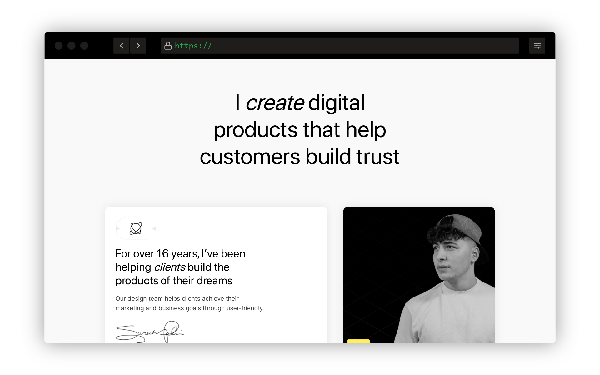
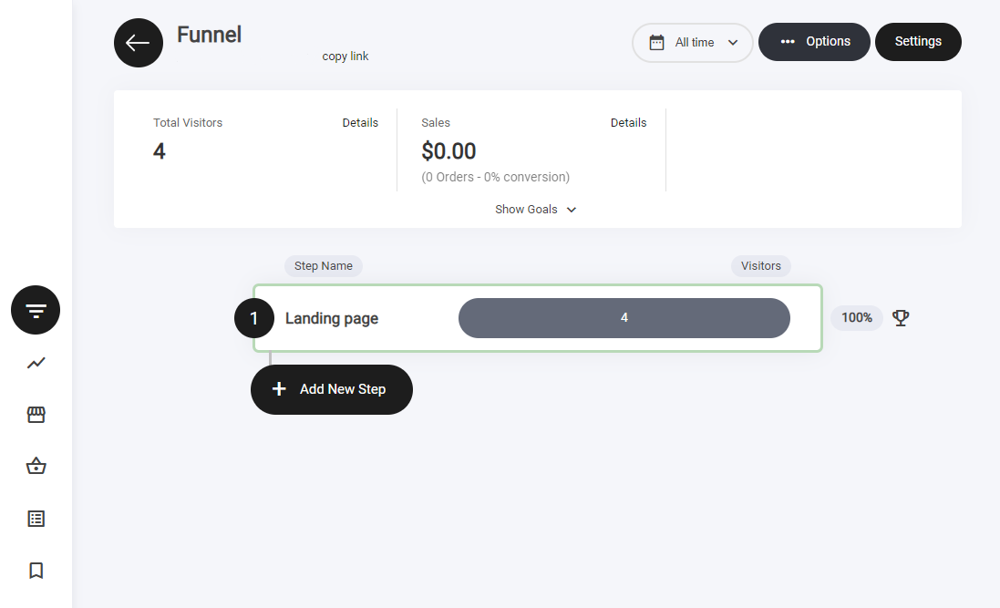
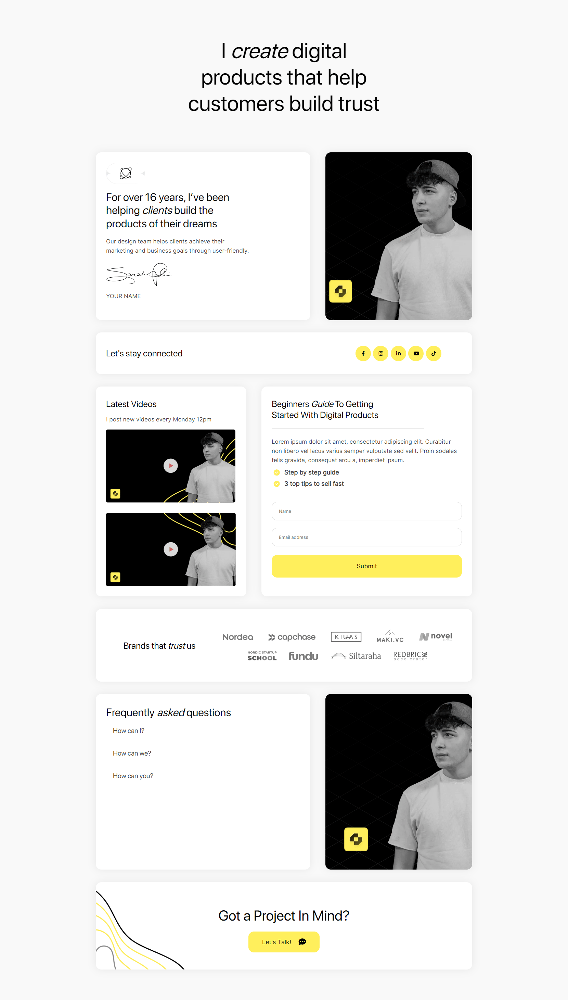

# ヒーロー


ヒーローファネルのテンプレートは、1つのファネルステップで構成されています。

1. ランディングページ


<figure><figcaption></figcaption></figure>

### ヒーローファネルとは？

ヒーローファネルは、コンテンツへの複数のリンクをまとめたランディングページを作成できる、ソーシャルメディアマーケティングでよく使われる手法です。プロフィールを頻繁に更新したり、リンク付きの投稿を繰り返し作成したりする代わりに、シンプルで視覚的に魅力的な1ページで複数のリンクをまとめてオーディエンスに共有できます。

独自のURLを持つランディングページを作成し、複数のクリック可能なボタンを配置して、それぞれをブログ記事、動画、商品、SNSプロフィール、外部サイトなどの特定のコンテンツにリンクさせられます。多様なコンテンツを共有したいものの、SNSのプロフィールや投稿をリンクだらけにしたくないビジネスや個人に特に有用です。ヒーローファネルを使えば、複数のリンクを簡単かつ効率的に共有できるうえ、マーケティングに役立つ分析機能も利用できます。

### ファネルのステップ

ビルダー内では、1ステップのファネルとして表示されます。これだけで機能するために必要なステップがすべて揃っています。

<figure><figcaption></figcaption></figure>


ファネルステップの横にある**トロフィーアイコン**は**目標達成**を示し、訪問者が重要なアクションを実行したことを表します。

**アナリティクスでのファネル目標の追跡：**

* **アクションによってトリガーされる** – フォームの記入、CTAのクリック、購入などが対象です。
* **ファネル分析で確認できる** – 達成されたすべての目標は**ファネル分析タブ**で確認できます。

コンバージョンの測定とパフォーマンス最適化に役立つ機能です。


### ファネル概要

このファネルは以下のステップで構成されています。

* ランディングページ

### ランディングページ

ランディングページは、コンテナウィジェットを土台に多くの要素を組み合わせて構築されています。ここでの主な目的はリードの獲得です。訪問者が行動を起こしたくなるだけの十分な情報を提供し、リード情報の取得には**フォームウィジェット**を使用します。ユーザーがフォームに入力すると、必要に応じて次のステップへ進みます。この過程でメールアドレスを取得し、メールリストに追加します。

ヒーローファネルのレイアウトは、情報が正しく表示され、読みやすく理解しやすいように複数のコンテナに分割されています。すべてのテンプレートには、何を書けばよいかの手がかりになる簡単なサンプルテキストが入っています。

<figure><figcaption></figcaption></figure>


**注意：** ファネルデザインのどの要素も、お好みに合わせて自由に編集できます。


### 登録フォームを置く場合のサンキューページ

テンプレートは1ステップですが、ページに読者登録のフォームを置くなら、送信後の行き先を用意しておくことをおすすめします。登録した直後に何も起きないと、届いたかどうかが相手に伝わりません。

方法は2つあります。

* **サンキューメッセージを出す** – フォーム設定の送信後のアクションで、その場に短いお礼を表示します。
* **サンキューページへ進める** – [ファネルステップの追加](../../platform/funnels/funnel-overview.md#add-new-funnel-step)の手順でページを1つ足し、フォーム設定の送信後の行き先をそのステップにします。

サンキューページには、登録へのお礼、このあと届くメールのこと、次に見てほしいリンクを1つ書きます。特典を約束した場合は、その受け取り方もここで伝えます。


フォームは、[フォームウィジェット](../../platform/widgets/form-widget.md)の設定でリストにつないでください。つないでいないと、登録は入っても、お礼のメールやその後の案内は届きません。


登録後に送るメールの並びは、[型別・登録後と購入後の自動メール](follow-up-emails.md)をご覧ください。

---

<!-- cta:opusbooster -->

**自分の場合はどう使えばいいか**

[ファネル機能の全体像](https://opusbooster.com/funnels)を見る。設計から相談したい方は[15分の無料相談](https://opusbooster.com/consultation)、まず触ってみたい方は[14日間の無料トライアル](https://opusbooster.com/register)（クレジットカード不要）から。

