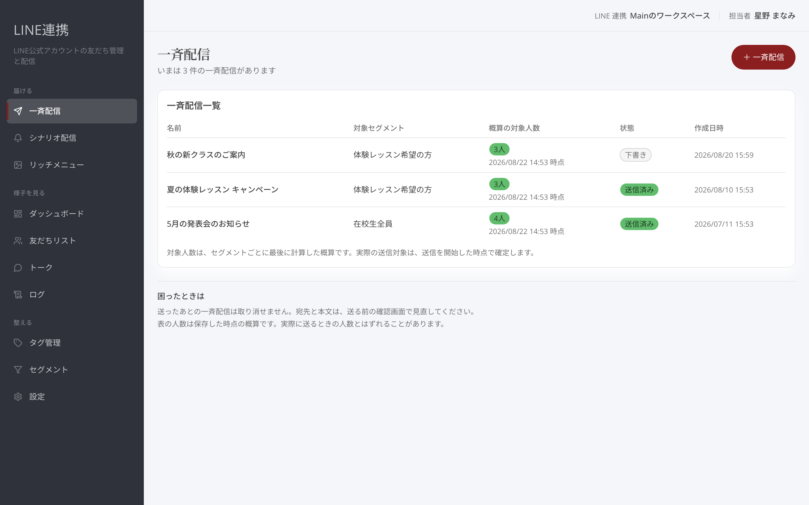
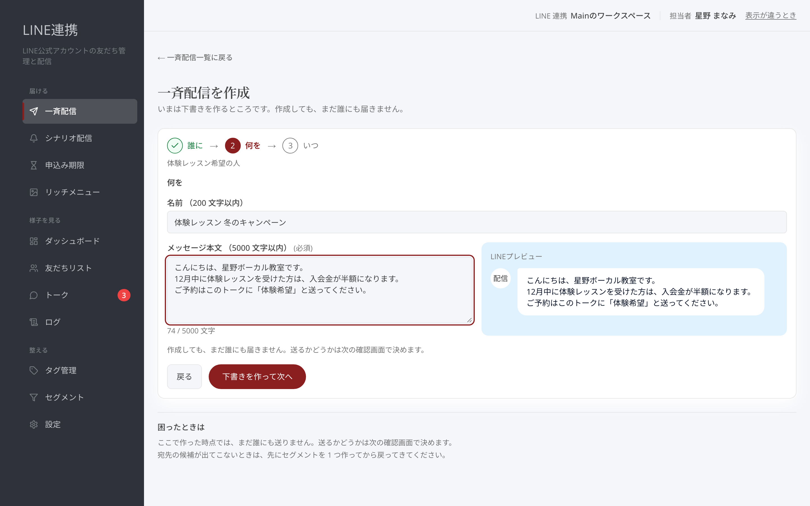
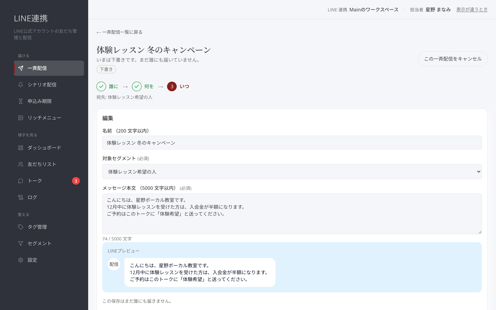
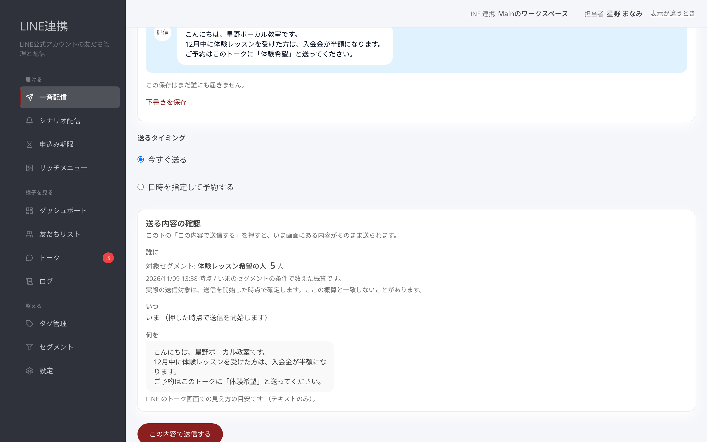
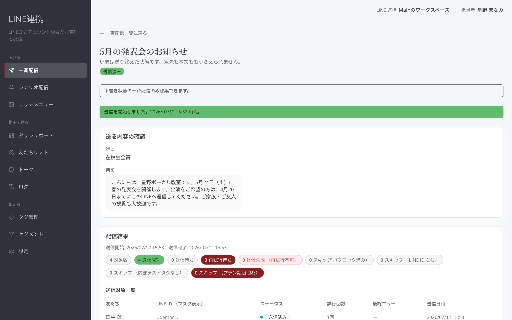

# 一斉配信を送る

## これは何のための機能？

一斉配信は、新曲のリリース案内やライブの告知などを、選んだセグメント（条件に合う友だちをまとめたグループ）へ送るための機能です。一覧画面で「**＋ 一斉配信**」を押すと、作成を始められます。

作成しただけでは送信されません。下書きを作り、内容と宛先を確認してから「**この内容で送信する**」を押します。

<figure><figcaption>一斉配信の一覧。「＋ 一斉配信」から新規作成します</figcaption></figure>

## 送るまでの流れ

### 1. 下書きを作成する

「**＋ 一斉配信**」を押すと、「**一斉配信を作成**」画面が開きます。上に「**誰に → 何を → いつ**」の進み具合が出ます。

1. **誰に**: 「**対象セグメント**」で、今回の案内を届けたい友だちのセグメントを選びます。選ぶと「**届く人: ◯ 人**」と人数が出ます。「**次へ**」を押します。
2. **何を**: 「**名前 （200 文字以内）**」に自分で見分けやすい配信名、「**メッセージ本文 （5000 文字以内）**」にLINEで届ける本文を入れます。横の「**LINEプレビュー**」に、LINEで届く見え方が入力に合わせて出ます。

<figure><figcaption>本文を入れると、横にLINEでの見え方が出ます</figcaption></figure>

入力できたら「**下書きを作って次へ**」を押します。この操作では、まだ誰にも届きません。次の画面 (いつ) で送るかどうかを決めます。宛先を選び直したいときは「**戻る**」を押してください。入力した内容は残ります。


**宛先の候補が出てこないとき:** 先にセグメントを1つ作成してから、この画面に戻ってください。


### 2. 本文と宛先を確認する

作成後は確認画面が開きます。上の進み具合は「**いつ**」になっています。下書きの間は、「**編集**」で名前・「**対象セグメント**」・「**メッセージ本文 （5000 文字以内）**」を変更できます。

途中で作業を止める場合は「**下書きを保存**」を押してください。保存しても送信はされません。保存していない変更があるまま画面を離れると、入力した内容は失われます。

<figure><figcaption>下書きの内容を整え、必要に応じて保存します</figcaption></figure>

編集欄の下にある「**送る内容の確認**」では、誰に・いつ・何を送るかを確認できます。対象人数は、いまのセグメントの条件で数えた概算です。実際の送信対象は、送信を開始した時点で確定するため、ここに表示された人数と一致しないことがあります。

本文はLINEのトーク画面での見え方の目安として表示されます。

<figure><figcaption>宛先・対象人数・本文を確認してから送信します</figcaption></figure>

### 3. 送信する

確認できたら「**この内容で送信する**」を押します。送信を開始した時点で宛先が確定します。


**送信前にもう一度確認してください:** 送ったあとの一斉配信は取り消せません。送信後は宛先も本文も変更できません。


## 送ったあとの見え方

送信を始めると、「**配信結果**」が表示されます。「**対象数**」「**送信成功**」「**送信待ち**」などの件数と、「**送信対象一覧**」を確認できます。状態は「**送信中**」「**送信済み**」などで一覧にも表示されます。

<figure><figcaption>送信後は配信結果と送信対象一覧を確認できます</figcaption></figure>

## よくある質問・つまずき

### 作成したのに、すぐ送られてしまいますか？

いいえ。「**下書きを作って次へ**」で作成するのは下書きです。送信は、確認画面で「**この内容で送信する**」を押して開始します。

### 対象人数が表示と違うことはありますか？

あります。確認画面の人数は概算で、実際の送信対象は送信を開始した時点で確定します。

### 送った本文を直したいです

送信後は本文も宛先も変更できません。送る前なら、下書き画面の「**編集**」で直し、「**下書きを保存**」できます。

---

<!-- cta:opusbooster -->

**自分の場合はどう使えばいいか**

[LINE連携の全体像](https://opusbooster.com/line)を見る。設計から相談したい方は[15分の無料相談](https://opusbooster.com/consultation)、まず触ってみたい方は[14日間の無料トライアル](https://opusbooster.com/register)（クレジットカード不要）から。

