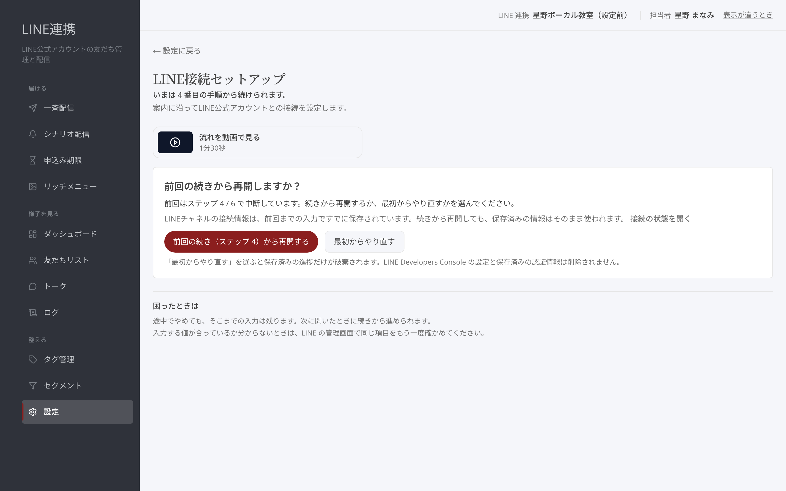
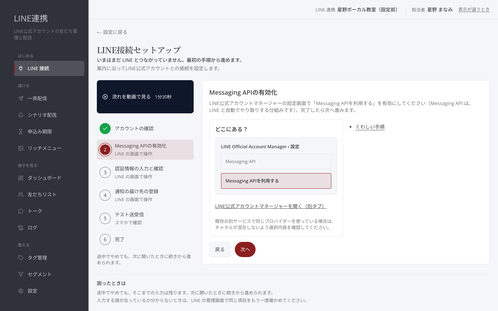
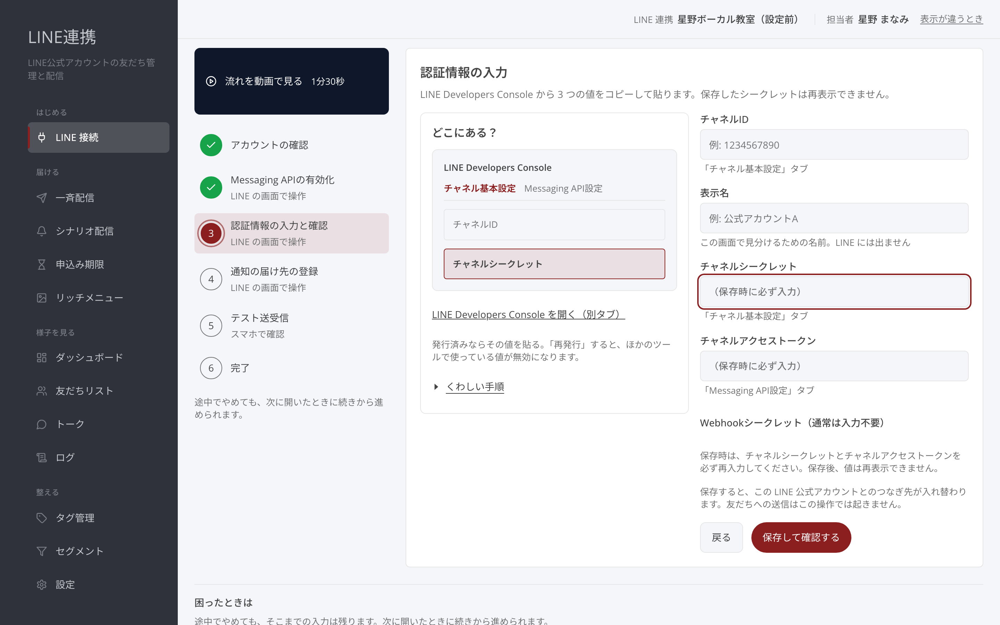
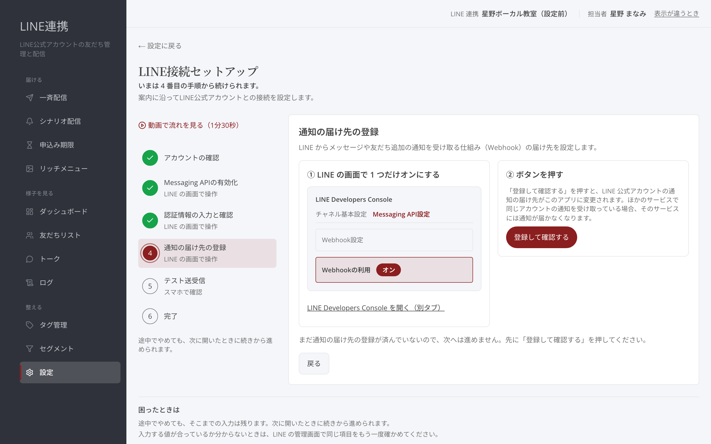
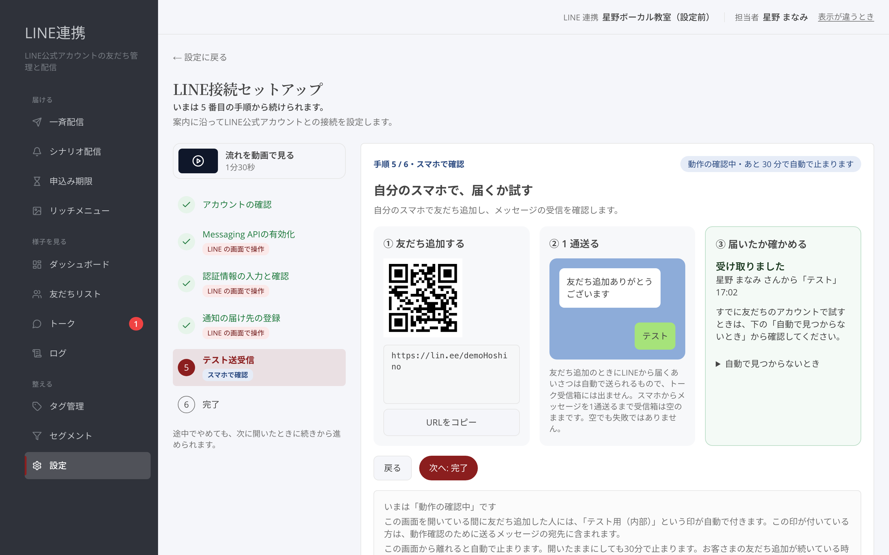
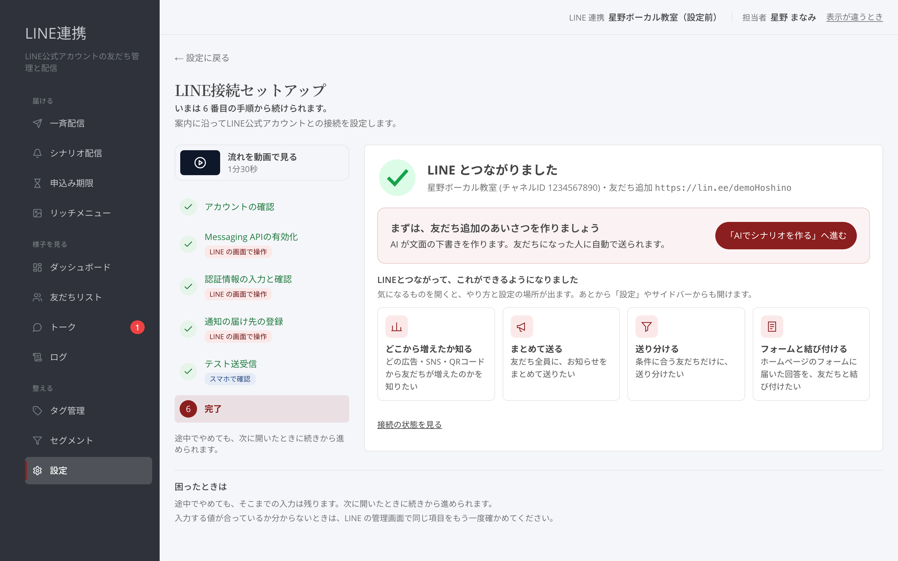
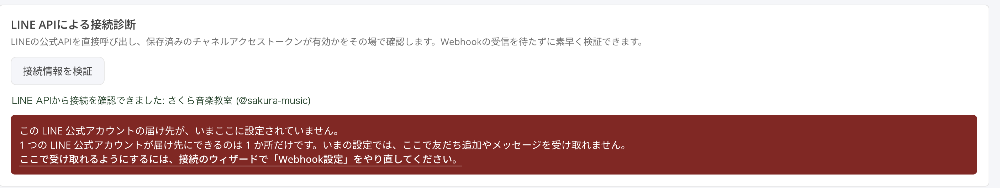

# 初期設定 — LINE接続ウィザード

## これは何のための機能？

「**LINE接続セットアップ**」は、案内に沿ってLINE公式アカウントとの接続を設定する画面です。6 つの手順のうち、LINE の画面で操作するのは 3 つ (手順 2・3・4) で、最後に自分のスマホで届くかを確かめます。ほかはこの画面が進めます。

画面の左に手順が縦に並び、済んだ手順には緑のチェック、いまの手順には番号が付きます。「**LINE の画面で操作**」「**スマホで確認**」の札で、どこで自分の操作が要るかが分かります。左の列の上の「**流れを動画で見る**」で、全体の流れを 1 分 30 秒の動画で見られます。

途中でやめても、次に開いたときに「**前回の続きから再開しますか？**」と出て、続きから進められます。

<figure><figcaption>途中でやめても、続きから再開できます</figcaption></figure>

## 6つの手順を進める

### 1. アカウントの確認

「**LINE公式アカウントをお持ちですか？**」で「**持っている**」か「**まだ持っていない**」を選びます。まだ持っていない場合は、作り方の案内が開きます。新しいアカウントは、LINE Developers ConsoleではなくLINE公式アカウントマネージャーから作成してください。


**すでに使っているLINE公式アカウントをつなぐとき:** いまのアカウントのまま接続できます。接続で変わるのはメッセージの届け先（Webhook URL）だけで、友だちやLINE公式アカウントマネージャーの設定は変わりません。

ただし、Lステップなど別のツールがWebhookを使っている場合は、接続するとそのツールにメッセージが届かなくなります。また、手順3でチャネルアクセストークンを「**再発行**」すると前のトークンは使えなくなり、そのトークンを使っている別のツールも止まります。別のツールを使っている方は、接続の前にサポートへご相談ください。


### 2. Messaging APIの有効化

LINE公式アカウントマネージャーで「**Messaging APIを利用する**」を有効にします。画面の「**どこにある？**」に、LINE公式アカウントマネージャーのどこを押すかが図で出ます。「**LINE公式アカウントマネージャーを開く（別タブ）**」から移動し、終わったら「**次へ**」を押します。文章で手順を見たいときは「**くわしい手順**」を開きます。

<figure><figcaption>「どこにある？」の図を見ながら進めます</figcaption></figure>

### 3. 認証情報の入力と確認

LINE Developers Consoleから 3 つの値 (チャネルID・チャネルシークレット・チャネルアクセストークン) をコピーして貼り、「**保存して確認する**」を押します。保存と同時に、そのトークンが LINE で使えるかを確かめ、問題がなければ次の手順へ進みます。

入力中の欄が LINE Developers Console のどこにあるかは、横の「**どこにある？**」の図で光って示されます。保存したシークレットは再表示できません。

<figure><figcaption>入力中の欄 (この例ではチャネルシークレット) の場所が、図で光ります</figcaption></figure>

確認がうまくいかなかったときは、そのままの画面で「**もう一度確認する**」を押せます (入れ直す必要はありません)。値を入れ替えたいときだけ、欄に入力し直して保存してください。すでに保存済みで入力し直さないときは「**確認して次へ**」で進めます。


**接続を入れ替えるとき:** すでに別のチャネルで接続している場合は、保存ボタンの上に注意が出ます。保存すると、この LINE 連携はいま入力したチャネルで動くようになり、前の接続は使われなくなります。友だちへの送信はこの操作では起きません。


### 4. 通知の届け先の登録

LINE からメッセージや友だち追加の通知を受け取れるようにします。

1. 「**① LINE の画面で 1 つだけオンにする**」: LINE Developers Console の「Messaging API設定」で「**Webhookの利用**」をオンにします。場所は図で示されます。
2. 「**② ボタンを押す**」: 「**登録して確認する**」を押します。届け先の登録と、届くかどうかの確認をまとめて行います。

押したあとは、確認の結果が ✓ で並びます。すべて確認できると「**次へ**」が出ます。足りないものがあるときは、その理由と「**もう一度確認する**」が出ます。

<figure><figcaption>① LINE の画面でオンにし、② ボタンを押します</figcaption></figure>

### 5. テスト送受信

自分のスマホで、メッセージが届くかを試します。

1. 「**① 友だち追加する**」: 画面の QR コードをスマホで読み取り、友だち追加します。
2. 「**② 1 通送る**」: そのトーク画面から「テスト」など短いメッセージを 1 通送ります。友だち追加のときに届くあいさつは自動で送られるもので、数えません。
3. 「**③ 届いたか確かめる**」: この画面が自動で確かめ、届くと「**受け取りました**」と出ます。「**次へ: 完了**」を押します。

この画面を開いている間に友だち追加した人には「**テスト用（内部）**」の印が付きます。自動で確かめるのは、この印が付いた友だちからのメッセージだけです。すでに友だちになっているアカウントで試すときは、「**自動で見つからないとき**」を開き、「**トーク受信箱を開く**」で届いたかを見てから「**テスト完了（受信を確認した）**」を押してください。

<figure><figcaption>スマホから送ったメッセージを、この画面が自動で受け取ります</figcaption></figure>


**動作の確認中:** この画面から離れると自動で止まります。開いたままでも 30 分で止まります。お客さまの友だち追加が続いている時間帯は、この画面を開いたままにしないでください。


### 6. 完了

「**LINE とつながりました**」と、つないだアカウントの名前・チャネルID・友だち追加の URL が出ます。

まずは「**「AIでシナリオを作る」へ進む**」(表示されないときは「**シナリオ配信を開く**」) から、友だち追加のあいさつを作るのがおすすめです。ほかにも「どこから増えたか知る」「まとめて送る」「送り分ける」「フォームと結び付ける」のカードから、それぞれのやり方と設定の場所を開けます。接続の状態は、下の「**接続の状態を見る**」から確かめられます。

<figure><figcaption>つながったら、まずは友だち追加のあいさつを作りましょう</figcaption></figure>

## よくある質問・つまずき

### 保存した認証情報を確認したいです

保存したシークレットは再表示できません。入力内容を手元で安全に管理してください。

### Webhookの手順で次へ進めません

LINE Developers Consoleで「**Webhookの利用**」をオンにしてから、「**登録して確認する**」を押してください。結果の一覧に、足りないものとその理由が出ます。

### 「届け先が、いまここに設定されていません」と表示されます

同じLINE公式アカウントを、別のウェブサイト・ファネルでも接続したときに出ます。

1つのLINE公式アカウントが友だち追加やメッセージを届けられるのは**1か所だけ**です。あとから設定した方に切り替わるため、先に設定していた方では受け取れなくなります。**接続そのものは有効なまま**なので、「**接続情報を検証**」は成功します。受け取りだけが止まっている状態です。

<figure><figcaption>接続は確認できても、届け先が別の場所に設定されている状態です</figcaption></figure>

**ここで受け取りたい場合**は、表示されているリンクから「**Webhook設定**」をやり直してください。接続済みでもこの手順だけをやり直せます。


**やり直すと、もう一方では受け取れなくなります。** 届け先は1か所だけなので、どちらで受け取るかを決めてから操作してください。両方で受け取ることはできません。それぞれのウェブサイト・ファネルで別々にLINE公式アカウントを使い分けてください。


### 同じLINE公式アカウントを複数のウェブサイトで使えますか

**使えません。** 1つのLINE公式アカウントがつながれるのは1か所だけです。ウェブサイト・ファネルごとに別のLINE公式アカウントをご用意ください。

見た目の上では複数の場所で「接続済み」と表示されることがありますが、実際に友だち追加やメッセージを受け取れるのは最後に設定した1か所だけです。受け取れていない方には「**届け先が、いまここに設定されていません**」と表示されます。

---

<!-- community:opusconnect -->

**同じところでつまずいた方は**

OpusConnect（OpusBoosterのユーザーコミュニティ）にも、操作でつまずいたときの質問と答えが集まっています。[OpusConnectを開く](https://opusbooster.com/me/opusconnect)（OpusBoosterへのログインが必要です）


<!-- cta:opusbooster -->

**自分の場合はどう使えばいいか**

[LINE連携の全体像](https://opusbooster.com/line)を見る。設計から相談したい方は[15分の無料相談](https://opusbooster.com/consultation)、まず触ってみたい方は[14日間の無料トライアル](https://opusbooster.com/register)（クレジットカード不要）から。

