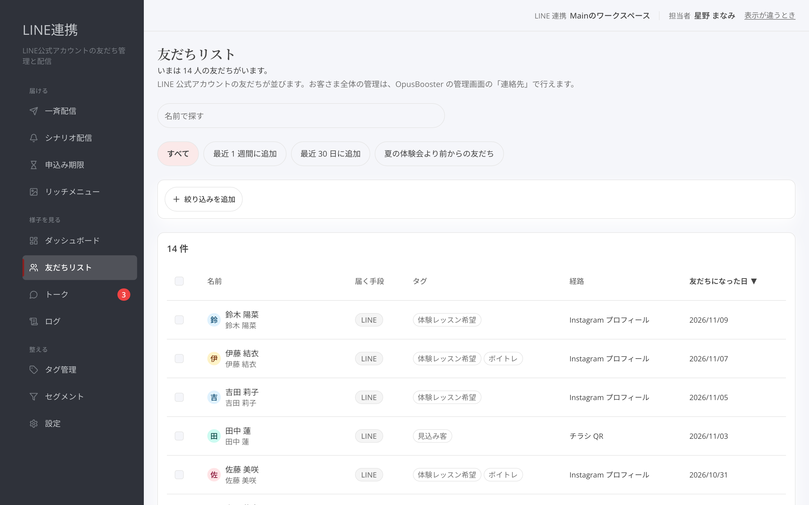
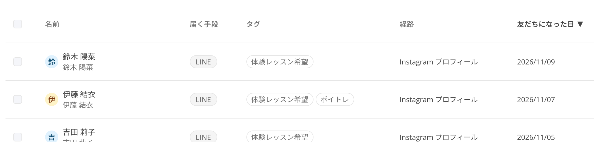
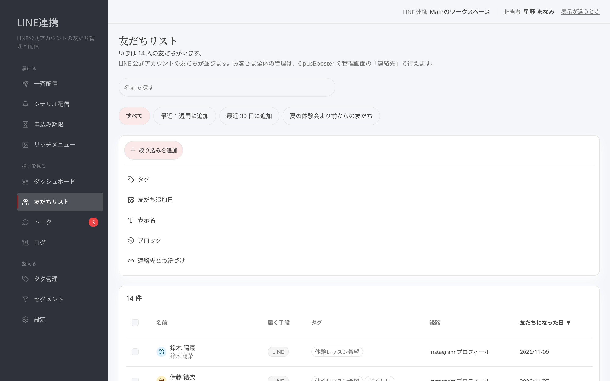
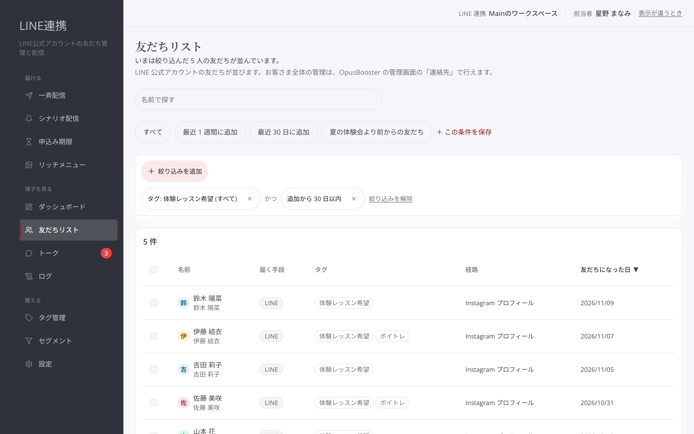

# 友だちリストと絞り込み

## これは何のための機能？

「**友だちリスト**」は、LINEで友だちになった方を確認し、必要な方を探すための画面です。友だちはこの画面から作れず、LINEの友だち追加によって増えます。新曲の案内前に対象を見たり、問い合わせをくれた方を探したりするときに使います。

<figure><figcaption>まず一覧で友だちを確認します</figcaption></figure>

## 一覧の列を確認する

一覧には、次の列が並びます。

| 列 | 内容 |
| --- | --- |
| **名前** | 友だちの名前。下に LINE での表示名 (なければ一部を伏せたメールアドレス) が出ます。ブロックされている人には「ブロック中」と出ます |
| **届く手段** | 「LINE」「メール」。その人にどの手段で届けられるか |
| **タグ** | 付いているタグ |
| **経路** | 友だち追加の入口 |
| **友だちになった日** | 友だちになった日付 |

一覧に人が見つからないときは、画面下の案内どおり「**絞り込みを解除**」してから並び替えを試します。絞り込みなしで友だちがいない場合と、条件に合う人がいない場合は意味が違うため、先に条件が残っていないかを確かめてください。

<figure><figcaption>名前・届く手段・タグ・経路・友だちになった日が並びます</figcaption></figure>

## 名前で探す

一覧の上の「**名前で探す**」に名前の一部を入れると、名前か LINE の表示名にその文字を含む人だけが並びます。ほかの条件はそのまま残ります。

## 条件を追加する

「**＋ 絞り込みを追加**」を押すと、条件の種類を選べます。選んだ種類により、入力欄や選択肢が変わります。タグで探すときは「**タグ**」、友だちになった時期で探すときは「**友だち追加日**」、名前の一部で探すときは「**名前**」を選びます。「**ブロック**」や「**連携済み**」も条件として選べます。

<figure><figcaption>タグ、友だち追加日、名前などから条件を選びます</figcaption></figure>

タグは選んだタグを条件にします。友だち追加日は表示された演算子と日数または日付を指定します。名前は探したい文字を入力します。条件を適用すると、選んだ条件はチップとして表示されます。チップ本体を押すと編集でき、×を押すとその条件だけ外せます。複数の条件があるときは、チップの間に「**かつ**」と表示されます。

<figure><figcaption>条件を見直し、不要なものだけ外せます</figcaption></figure>


**探す順番:** 最初は「**＋ 絞り込みを追加**」で1つだけ条件を入れ、結果を見てから次の条件を加えてください。条件が増えるほど、一覧に出る人は絞られます。


## よく使う条件を保存する

条件を付けた状態で、上のタブの並びにある「**＋ この条件を保存**」を押すと、名前を付けて保存できます。保存した条件は「**セグメント**」になり、一覧の上に「**すべて**」と並んでタブとして出ます。次からはタブを押すだけで、同じ条件の一覧を開けます。セグメントは一斉配信の宛先にもそのまま使えます。

「セグメント」の画面で作った条件のうち、この一覧の絞り込みでは表せないもの (「タグを持たない」など) はタブには出ません。

## よくある質問・つまずき

### 友だちを手で追加できますか？

できません。友だちはLINEの友だち追加によって増えます。

### 条件を1つだけ外したいです

条件チップの×を押すと、その条件だけ外せます。

### 探している人がいません

「**絞り込みを解除**」してから、一覧や並び替えを確認してください。

---

<!-- cta:opusbooster -->

**自分の場合はどう使えばいいか**

[LINE連携の全体像](https://opusbooster.com/line)を見る。設計から相談したい方は[15分の無料相談](https://opusbooster.com/consultation)、まず触ってみたい方は[14日間の無料トライアル](https://opusbooster.com/register)（クレジットカード不要）から。

