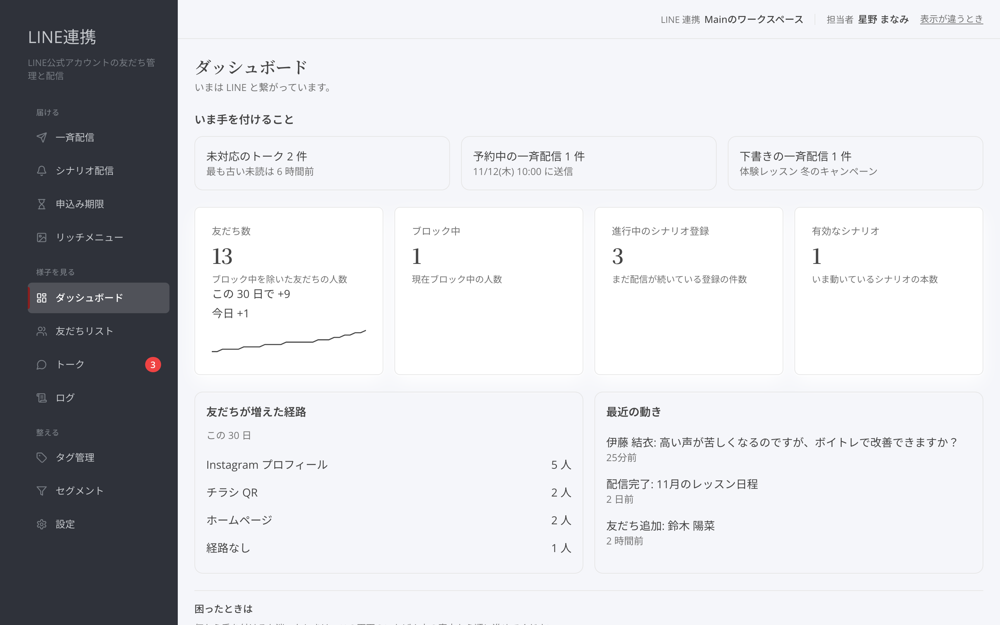
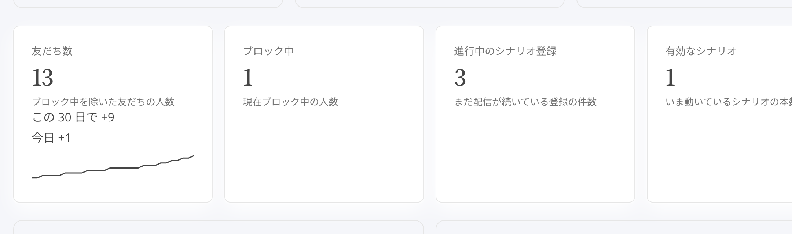
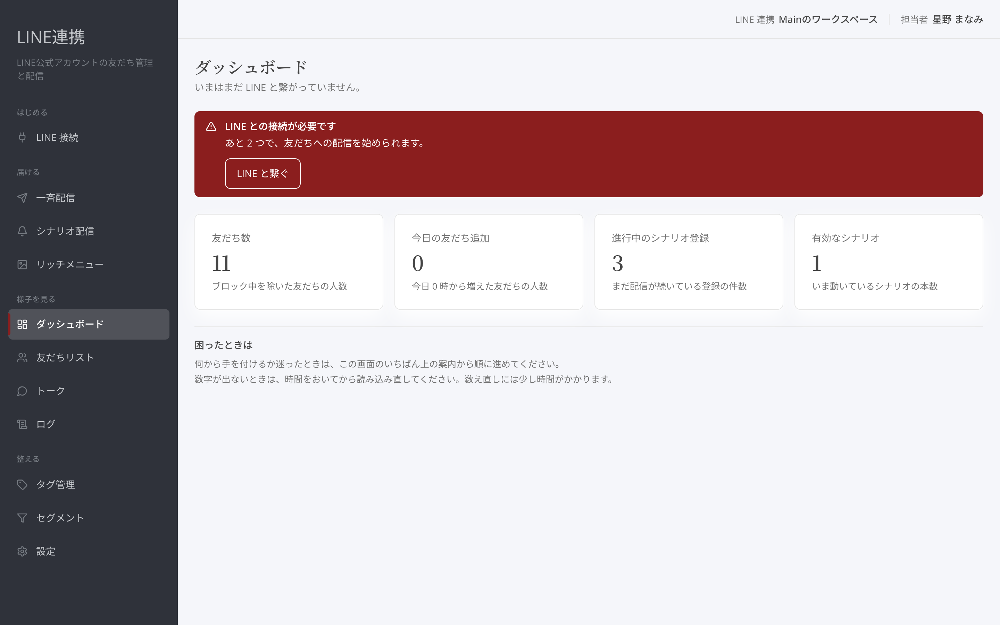

# ダッシュボードの見方

## これは何のための機能？

「**ダッシュボード**」は、LINE連携で次に確認したいことを見つける入口です。日々の状態では、いま手を付けること・4つの数字・友だちが増えた経路・最近の動きが表示され、押すと内容の一覧へ移動できます。ライブ告知や新作のお知らせのあと、まず全体を確かめたいときに開いてください。

<figure><figcaption>数字を押すと、詳しい一覧を開けます</figcaption></figure>

## いま手を付けること

画面のいちばん上には、対応が必要なものだけが並びます。

* 「**未対応のトーク**」: 友だちからメッセージが届いていて、まだ「未対応」の会話の数です。押すと、未対応のトークが開きます。
* 「**予約中の一斉配信**」: 送る日時を予約してある一斉配信の数と、次に送る日時です。
* 「**下書きの一斉配信**」: まだ送っていない下書きの数と、いちばん新しい下書きの名前です。

0件のものは表示されません。どれも0件のときは、この欄そのものが出ません。

## 4つの数字を読む

「**友だち数**」は、ブロック中を除いた友だちの人数です。下に「この 30 日で +◯」「今日 +◯」と、30日間の増え方を表す折れ線が出ます。告知のあとにどれくらい友だちが増えたかを確かめられます。押すと「**友だちリスト**」へ進みます。

「**ブロック中**」は、いまブロックされている人数です。

「**進行中のシナリオ登録**」は、まだ配信が続いている登録の件数です。「**有効なシナリオ**」は、いま動いているシナリオの本数です。どちらも「**シナリオ配信**」の一覧へ進む入口です。数字を見て気になったら、カードを押して中身を確認してください。

<figure><figcaption>友だち数には、30日間の増え方が出ます</figcaption></figure>


**折れ線の目安:** 折れ線は、いま友だちの人が、それぞれいつ友だちになったかから描いています。途中でブロックして戻った人の出入りは反映されません。


## 友だちが増えた経路と最近の動き

「**友だちが増えた経路**」には、この30日に友だちになった人が、どの友だち追加の入口から来たかが人数の多い順に並びます。入口が分からない人は「**経路なし**」にまとまります。

「**最近の動き**」には、最後に届いたメッセージ、最後に送った一斉配信、最後に友だちになった人が出ます。

数字が表示されないときも、すぐに0件とは限りません。「取得できませんでした」と出たときは、時間をおいてから読み込み直してください。

## 最初の設定が残っているとき

接続がまだ済んでいない場合は「**LINE との接続が必要です**」と表示されます。「**接続を確認する**」または表示された案内から、設定を進めてください。接続できない場合は「**LINE と接続できません**」と表示され、配信と友だちの取り込みは止まっています。接続の状態画面で原因を確かめます。

<figure><figcaption>表示された案内から接続の設定を進めます</figcaption></figure>


**数字の使い方:** 数字は結果を眺めるだけでなく、気になる項目の一覧へ進むための入口です。まずカードを押して、該当する友だちやシナリオを確認してください。


## 困ったときは

友だちが増えない理由を見たいときは「**友だちリスト**」へ、返信を確かめたいときは「**トーク**」へ進みます。届かないなど記録を確認したいときは「**ログ**」を開きます。ダッシュボード上の数字だけでは原因を示さないため、数字から行き先を選んで確認するのが近道です。

## よくある質問・つまずき

### 数字が空です

時間をおいてから読み込み直してください。数え直しには少し時間がかかります。

### 友だち数を押すと何が開きますか？

「**友だちリスト**」が開き、友だちの一覧を確認できます。

### 接続できない案内が出ています

「**接続を確認する**」を押し、接続の状態画面で原因を確かめてください。

---

<!-- cta:opusbooster -->

**自分の場合はどう使えばいいか**

[LINE連携の全体像](https://opusbooster.com/line)を見る。設計から相談したい方は[15分の無料相談](https://opusbooster.com/consultation)、まず触ってみたい方は[14日間の無料トライアル](https://opusbooster.com/register)（クレジットカード不要）から。

