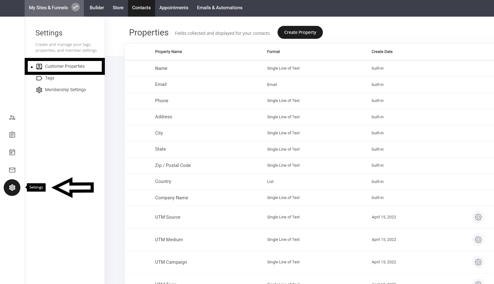
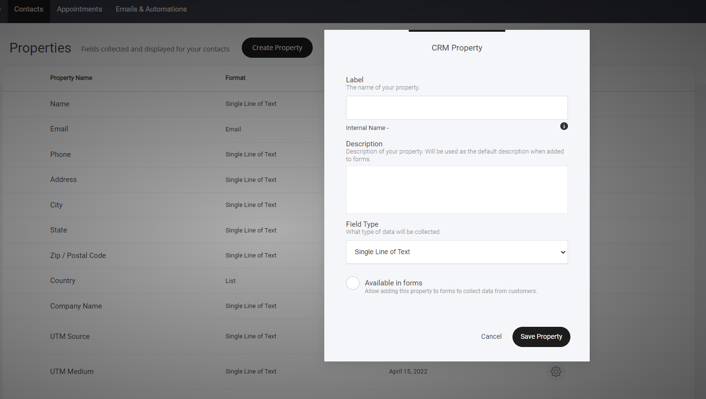

# プロパティ

### プロパティとカスタムプロパティ

プロパティは、連絡先ごとに残しておく項目（名前・メール・電話番号など）のことです。

**連絡先**を開き、左の列の歯車アイコン（**設定**）→ **顧客情報**を選ぶと、いまある項目が一覧で表示されます。

最初から用意されている項目（「ビルトイン」と表示されるもの）は、名前・メール・電話番号・住所・区市町村・都道府県・郵便番号・国・会社名です。

### カスタムプロパティ 

用意されている項目のほかに、自分で項目を足せます。たとえば体験レッスンの申し込みで「楽器の経験」を聞きたいときです。

1. **顧客情報**の一覧の上にある「**プロパティを作成**」を押します
2. **ラベル**に項目の名前を入れます（例: 楽器の経験）。**説明**は空でもかまいません
3. **項目**で形式を選びます（最初は「1行のテキスト」が選ばれています）
4. フォームで聞きたいときは「**フォームで利用可能**」にチェックを入れます
5. 「**プロパティを保存**」を押します

**選べる形式**

* 1行のテキスト
* メールアドレス
* 電話
* 数値
* はい / いいえ
* 日付
* リスト


**項目は、あとで使うと決めたものだけ足してください**

フォームで聞くことが増えるほど、登録してくれる人は減ります。送り分けやレッスンの準備に使う項目だけに絞るのがおすすめです。


### **フォームでも利用できます** 

「**フォームで利用可能**」にチェックを入れた項目は、登録フォームの項目として使えるようになります。※フォーム設定の「隠しフィールドタイプ」で、フィールドを非表示にすることもできます。

---

<!-- cta:opusbooster -->

**自分の場合はどう使えばいいか**

[OpusBoosterの機能全体](https://opusbooster.com/all-features)を見る。設計から相談したい方は[15分の無料相談](https://opusbooster.com/consultation)、まず触ってみたい方は[14日間の無料トライアル](https://opusbooster.com/register)（クレジットカード不要）から。

