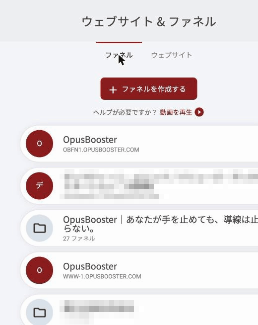
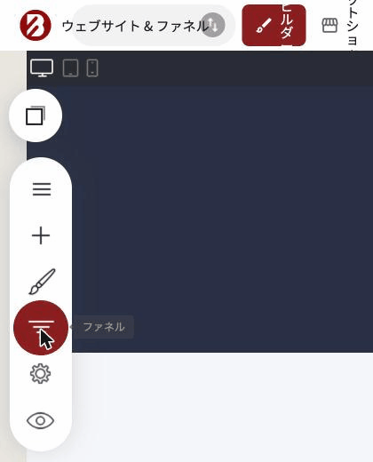
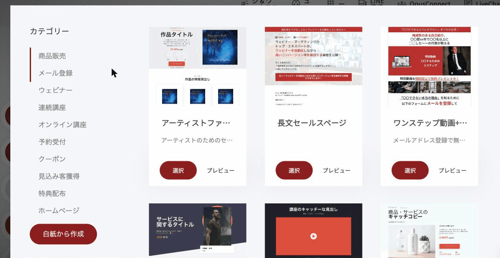
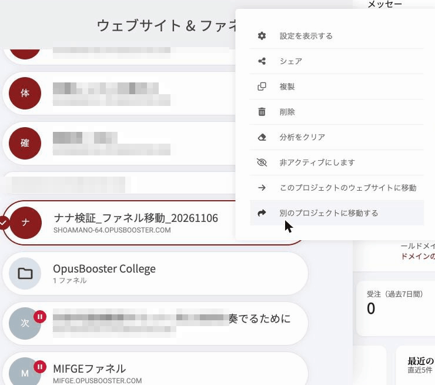
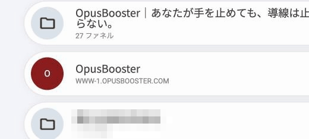
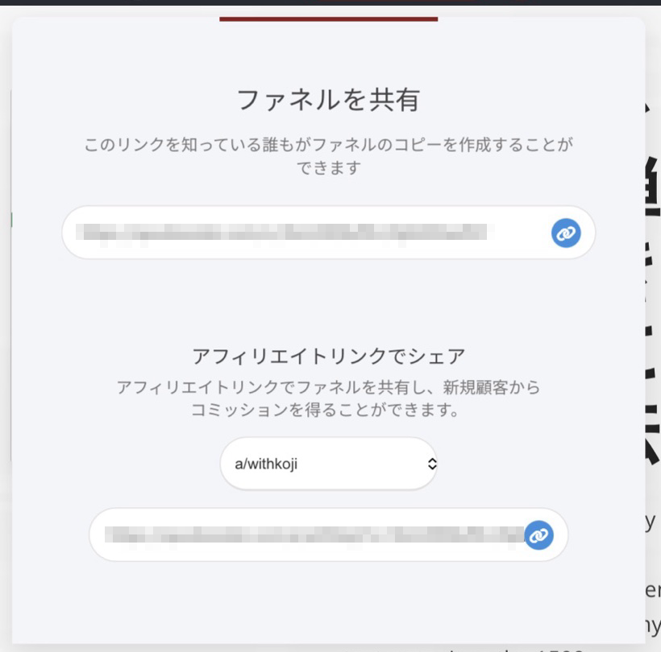

# ファネルの管理（場所・移動・シェア）

ファネルは、作ったあとに「どこに置くか」「誰と共有するか」を変えられます。この記事では、ファネルの一覧の見方、ウェブサイトへの出し入れ、他の人へのシェアを順に説明します。

### ファネルはどこにあるか 

ファネルの一覧は2か所から開けます。

**1. 画面上部の「ウェブサイト＆ファネル」**

ビルダーのダッシュボード上部にある **ウェブサイト＆ファネル** をクリックすると、アカウント内のすべてのウェブサイトとファネルがパネルで表示されます。

<figure><figcaption>
「ウェブサイト＆ファネル」を開いたパネル。上に「ファネル」「ウェブサイト」のタブがあります
</figcaption></figure>

パネルは2つのタブに分かれています。

* **ファネル**: 作成したすべてのファネル
* **ウェブサイト**: 作成したすべてのウェブサイト

**2. 左側ツールバーの「ファネル」**

編集中のプロジェクトのファネルだけを見るなら、画面左側ツールバーの **ファネル** をクリックします。

<figure><figcaption>
左側ツールバーの「ファネル」アイコン
</figcaption></figure>

### 新しいファネルを作る 

**ファネルを作成する** をクリックすると、ファネルテンプレートの一覧が開きます。使いたいデザインを選び、名前を付けて保存すると、一覧に新しいファネルが追加されます。

<figure><figcaption>
ファネルテンプレートの一覧。左のカテゴリーで絞り込めます
</figcaption></figure>

### ファネルの置き場所を変える 

アカウントを作ると、まず1つの「プロジェクト」ができます。プロジェクトの中には、ウェブサイト1つと、複数のファネルを置けます。

ファネルは、次のどちらの形でも持てます。

* **ウェブサイトの中に入れる**: ウェブサイトと同じプロジェクトに属し、顧客情報・商品・メールオートメーションをウェブサイトやほかのファネルと共有できる
* **独立させる**: ウェブサイトとは別のURLで動く、単体のファネル


1つのブランドで複数のファネルを運用するなら、先にウェブサイトを作り、その中にファネルを作る順番がおすすめです。理由は「[ウェブサイトとファネルについて](../getting-started/websites-and-funnels.md)」をご覧ください。


#### ファネルをウェブサイトに入れる 

1. **ウェブサイト＆ファネル** を開き、**ファネル** タブで移動したいファネルを見つけます
2. ファネル右側の **歯車アイコン** をクリックします
3. **このプロジェクトのウェブサイトに移動** をクリックします
4. 移動先のウェブサイトを選びます
5. 確認のメッセージが出ます。内容を確認して **はい** を押します

> 選択したウェブサイトにファネルを移動してもよろしいですか？店舗商品、注文、メンバー、連絡先とメッセージは移動されません。続けますか？

<figure><figcaption>
ファネル右側の歯車アイコンを押すと出るメニュー
</figcaption></figure>


**移動すると、そのファネルに登録していた商品・注文・メンバー・連絡先・メッセージ・オートメーションは使えなくなります。** 移動先のウェブサイトには引き継がれず、移動後に独立に戻しても復活しません。これらのデータが入っているファネルは、移動する前に必ずバックアップ（連絡先のエクスポート、商品情報の控え）を取ってください。


移動が終わると、**ファネル** タブでそのファネルがウェブサイトに属している表示に変わります。同じウェブサイトにファネルをもう1つ入れると「2 ファネル」のように、属しているファネルの数が表示されます。

<figure><figcaption>
ウェブサイトの行に、属しているファネルの数が表示されます
</figcaption></figure>

#### ファネルをウェブサイトから切り離す 

ウェブサイトの中にあるファネルを、独立したファネルに戻すこともできます。

1. **ウェブサイト＆ファネル** で、切り離したいファネルの **歯車アイコン** をクリックします
2. **ウェブサイトの外に移動する** を選びます
3. 確認のメッセージが出ます。内容を確認して **はい** を押します

> ウェブサイト内にあるファネルを独立させますか？商品、受注、メンバー、連絡先リスト、メッセージは移動されませんので、ご注意ください。リストを残す場合はファネルを複製して独立させてください。


切り離してもファネルのページは削除されません。商品・連絡先などのデータはウェブサイト側に残り、独立したファネルには付いていきません。連絡先などを持たせたまま独立させたい場合は、メッセージにあるとおり、先にファネルを **複製** してから複製側を独立させてください。


### ファネルを他の人にシェアする 

作ったファネルを、丸ごと他の人に渡せます。たとえば、自分のセールスファネルを気に入った知り合いに渡したり、ファネルのデザインを販売したりする使い方ができます。

1. **ウェブサイト＆ファネル** で、シェアしたいファネルの **歯車アイコン** をクリックします
2. **シェア** を選びます
3. 「ファネルを共有」の画面が開き、専用のリンクが表示されます。右のコピーアイコンでコピーして、相手に送ります

<figure><figcaption>
「ファネルを共有」の画面。上がシェア用のリンク、下がアフィリエイトリンク
</figcaption></figure>

このリンクを知っている人は誰でも、そのファネルのコピーを自分のアカウントに作れます。渡るのはファネルのページとデザインで、商品・連絡先などのデータは含まれません。

販売する場合は、このリンクを購入後のメールに入れたり、購入完了ページのリダイレクト先にしたりする使い方ができます。


同じ画面の下段に「アフィリエイトリンクでシェア」があります。こちらのリンクで共有すると、相手が OpusBooster を新しく契約したときにアフィリエイト報酬の対象になります。


***


**自分の場合はどう使えばいいか**

[OpusBoosterの機能全体](https://opusbooster.com/features)を見る。設計から相談したい方は[15分の無料相談](https://opusbooster.com/consultation)、まず触ってみたい方は[14日間の無料トライアル](https://opusbooster.com/register)（クレジットカード不要）から。

