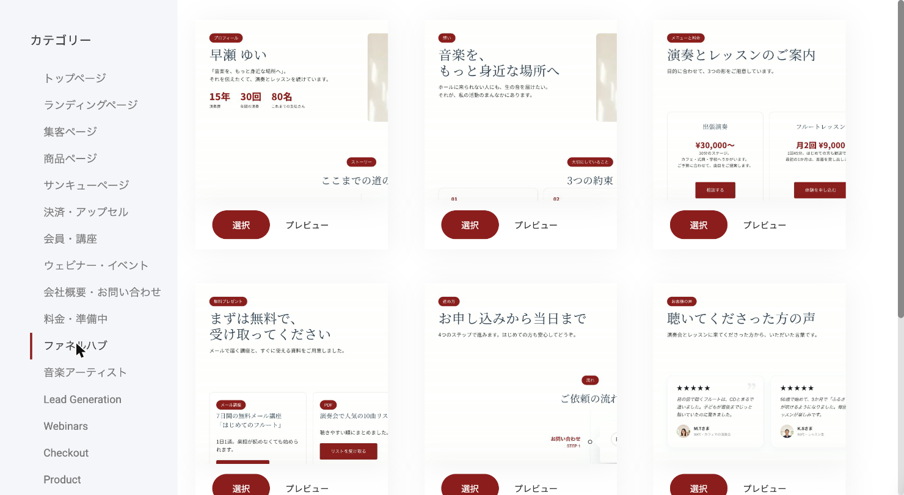
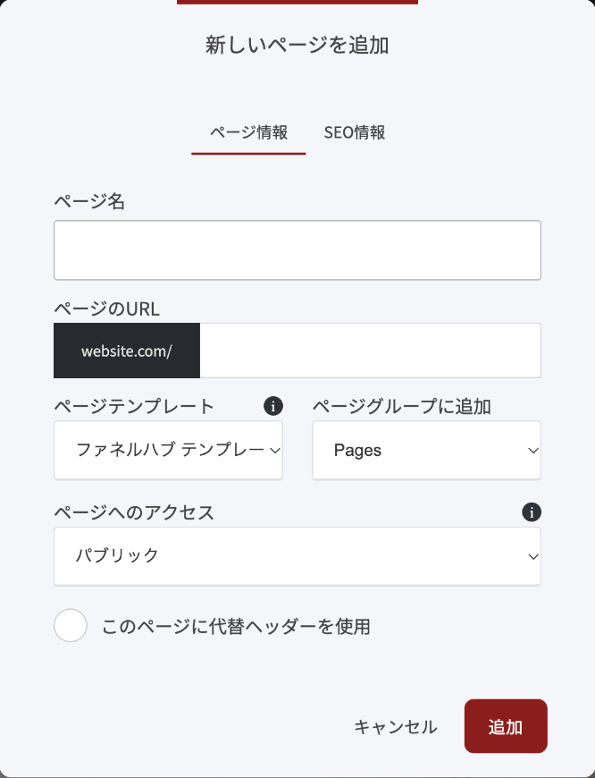
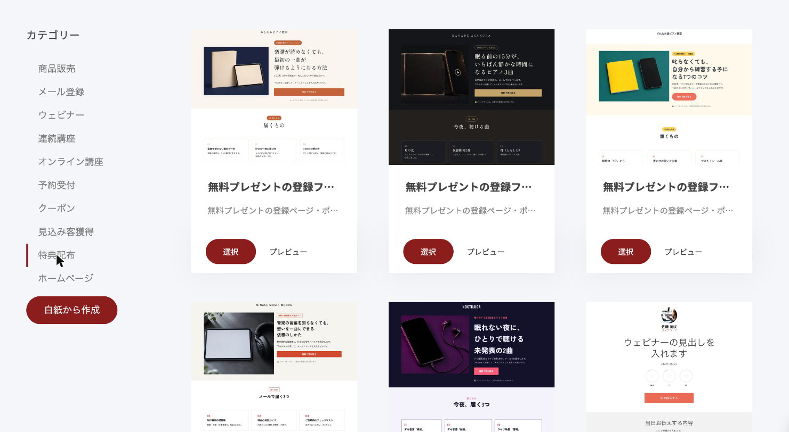

# 自己紹介ページから始めて、サイトを育てる

最初の1ページ（自己紹介ページ）ができたら、次はページを1枚ずつ足していきます。全部を一度に作る必要はありません。この記事の順番で足していくと、最後には、あなたの活動の入口が全部そろったサイトになります。

## 全体の流れ

1. 足すページを決める
2. 色と書体を決める
3. ページを1枚ずつ足す
4. 無料プレゼントの登録の流れを足す
5. 最後に、最初のページを仕上げる
6. リンクを全部押して確かめる


**最初のページを仕上げるのは、最後にします**

最初のページ（トップページ）は、ほかのページの大事な所を少しずつ集めて作ります。先にほかのページがあると、早く、迷わず仕上げられます。


## 1. 足すページを決める

役割ごとのページのひな形を、6枚用意しています。全部でなくてかまいません。まず2〜3枚から始めて、あとで足せます。

| ページ | 役割 |
| --- | --- |
| プロフィール | あなたがどんな人で、なぜこの活動をしているかを伝える |
| 想い | 大切にしていること、どんな人と歩みたいかを伝える |
| メニューと料金 | 演奏・レッスン・作品など、提供しているものと料金を並べる |
| 無料プレゼント | メールアドレスと引き換えに渡すもの（音源・PDF・メール講座など）を案内する |
| 進め方 | 申し込みから当日までの流れを見せて、不安をなくす |
| お客様の声 | 生徒さん・お客様の感想を集める |

## 2. 色と書体を決める

ページを足す前に、サイト全体の色を決めておきます。足したページは、ここで決めた色で表示されます。

1. 編集画面の左側にある、絵筆のアイコンを押します。「共通スタイリング」の窓が開きます。
2. 「**カラーパレット**」を開き、基調色（いちばん左の丸）を押して、あなたの色を1つ入れ、「**確認**」を押します。ボタンや小さなラベル、色つきの帯に使われる色です。
3. 「テキストスタイリング」で、見出しと本文の書体を選びます。
4. 窓を閉じて、上のバーの「**保存**」を押します。

ひな形のページは、基調色と白を中心に組んであります。基調色を1つ決めるだけで、足したページ全体がその色でそろいます。

くわしくは [色と装飾を、1か所で決める](https://docs.opusbooster.com/platform/website-funnel-builder/global-styles) をご覧ください。

## 3. ページを1枚ずつ足す

1. 編集画面の左側にある、3本線のアイコンを押して「ページ & ポップアップ」を開きます。
2. 「**新しく追加する**」を押し、「**ページ**」を選びます。
3. 左のカテゴリーから「**ファネルハブ**」を選びます。6枚のひな形が並びます。

<figure><figcaption>
カテゴリー「ファネルハブ」を選ぶと、6枚のひな形が並びます。
</figcaption></figure>

4. 足したいページの「**選択**」を押します。中身を先に見たいときは「プレビュー」を押します。
5. 「新しいページを追加」の窓で、「**ページ名**」を入れます。「ページのURL」には、`profile` のような短い英語の名前を入れてください。

<figure><figcaption>
「新しいページを追加」の窓。ページ名と、ページのURLを入れます。
</figcaption></figure>

6. 「**追加**」を押すと、ページができます。
7. 見本の文言と写真を、あなたのものに差し替えて、上のバーの緑の「**保存**」を押します。


**ページ名が日本語のときは、URL欄を自分で入れてください**

ページ名を日本語で入れると、「ページのURL」の欄は空のままです。`profile` や `menu` のような短い英語の名前を入れてから「追加」を押してください。


見本の文言は、フルート奏者の例で書いてあります。あなたの楽器・教室・作品に合わせて、書き換えてください。写真は、写真を1回クリックして「画像を編集」から差し替えます。

1枚できたら、公開ページを開いて、読みやすいかを確かめてから次のページへ進みます。

くわしくは [新規ページの追加](https://docs.opusbooster.com/platform/website-funnel-builder/add-pages) をご覧ください。

### 足したページを、上のメニューに出す

足したページは、自動ではメニューに入りません。ページの上の部分（ヘッダー）にメニューを1つ置いて、そこにページを足します。ヘッダーは全ページ共通なので、1回の作業で全部のページに出ます。

1. 編集画面で、ページのいちばん上（サイト名の横の空いている所）をクリックします。
2. ヘッダーの中に出る「**＋**」を押し、「ウィジェットを追加」の一覧から「**メニュー**」を選びます。
3. 右の「編集」のパネルで「**メニュー項目を追加する**」を押します。
4. 「リンクを選択します」の窓で「**ページ**」を選び、出したいページを選んで「**選択**」を押します。メニューの名前には、ページ名がそのまま入ります。
5. 出したいページの数だけ、3〜4をくり返します。
6. ページの本文をクリックしてパネルを閉じ、上のバーの「**保存**」を押します。

左上のサイト名は、最初のページへ戻るリンクになっています。

### 商品をその場で買えるようにしたいとき

「メニューと料金」のページで、音源・グッズ・チケットなどをその場で買えるようにしたいときは、先にネットショップで商品を登録してから、ページにストアの部品を置きます。はじめての方は、先にネットショップの設定で、国を「日本」、通貨を「Japanese Yen (¥)」、税金を「消費税 10%」にしてください。

くわしくは [ネットショップ概要](https://docs.opusbooster.com/platform/online-shop/shop-overview) と [ストアウィジェット](https://docs.opusbooster.com/platform/widgets/store/store-widget) をご覧ください。

## 4. 無料プレゼントの登録の流れを足す

メールアドレスを登録してもらう流れは、3つのステップでできています。

1. 登録ページ（プレゼントの中身を伝えるページ。メニューは出しません）
2. ポップアップ（ボタンを押すと開く、メールアドレスの入力欄）
3. お礼のページ（登録のお礼と、次の一歩の案内）

この3つがそろったひな形を、5種類用意しています（音楽教室／ピアニスト・演奏家／子どもピアノ教室／作曲家・編曲家／バンド・ユニット）。

1. 編集画面の上のバーの「**ウェブサイト & ファネル**」を押し、「ファネル」のタブで「**ファネルを作成する**」を押します。
2. 左のカテゴリーから「**特典配布**」を選びます。
3. 一覧のいちばん上に、「**無料プレゼントの登録ファネル**」で始まる5つが並んでいます。あなたの活動に近いものの「**選択**」を押します。

<figure><figcaption>
カテゴリー「特典配布」の先頭に、無料プレゼントの登録ファネルが並びます。
</figcaption></figure>

4. 「ファネル名」の窓で名前を入れて、「**保存**」を押します。
5. 見本の文言と写真を、あなたのものに差し替えます。


**プレゼントを届けるメールは、自分で用意します**

ひな形に入っているのは、登録ページ・ポップアップ・お礼のページの3つです。登録した人にプレゼントを届けるメールは入っていません。お礼のページには「メールでお届けします」と書いてあるので、案内を始める前に、次の2つを済ませてください。

1. メールを送るためのドメインを認証する（認証が済むまで、自動のメールは動きません）
2. リストに入った人へ自動で届くメール（オートメーション）を作って、オンにする

くわしくは [メールドメインの接続](https://docs.opusbooster.com/platform/email-and-automation/email-domain-connection)、[オートメーション概要](https://docs.opusbooster.com/platform/email-and-automation/automation)、[型別・登録後と購入後の自動メール](https://docs.opusbooster.com/funnel-designs/types-of-funnels/follow-up-emails) をご覧ください。


作ったら、次の2つを確かめます。

- **登録した人が入るリスト**: ポップアップの入力欄を選び、歯車の「フォーム設定」を開いて、下のほうにある「メッセージ＆ワークフローに接続」の「**リストの選択**」を押します。ひな形には、見本のリスト（例「ライブ音源3曲」）が最初からつながっています。そのまま使うか、あなたのリストに付け替えてください。リストにつながっていないと、あとでお知らせを送れません。
- **お礼のページのボタンの行き先**: 「コンサート日程を見る」「体験レッスンの日程を見る」などのボタンは、行き先が入っていません。あなたの予約ページやスケジュールのページに向けてください。

くわしくは [ファネルの管理（場所・移動・シェア）](https://docs.opusbooster.com/platform/funnels/manage-funnels)、[フォームウィジェット](https://docs.opusbooster.com/platform/widgets/lead-generation/form-widget)、[購読者リスト](https://docs.opusbooster.com/platform/email-and-automation/email-lists) をご覧ください。

## 5. 最後に、最初のページを仕上げる

ページがそろったら、最初に作った自己紹介ページに戻って、下へセクションを足していきます。新しく書く必要はほとんどありません。ほかのページの大事な所を、少しずつ持ってきます。

- プロフィールから: 写真と、ひとことの紹介 →「プロフィールを読む」ボタン
- メニューと料金から: 代表的なメニューを3つ →「メニューを見る」ボタン
- お客様の声から: 感想を1〜3件 →「もっと読む」ボタン
- 無料プレゼントから: プレゼントの案内 → 登録のボタン

最初のページの役目は、来た人をそれぞれのページへ案内することです。全部を載せず、続きは各ページへ送ります。

## 6. リンクを全部押して確かめる

公開ページを開いて、次を確かめます。

- 足したページのボタンが、意図した行き先へ移動する（ひな形のボタンは、行き先が空のままです）
- 登録のボタンを押すとポップアップが開き、自分のメールアドレスで登録すると、お礼のページへ移動する
- 連絡先の一覧に、いま登録した自分のアドレスが入っている
- スマホで開いても、文字が切れたり、はみ出したりしていない

## 最初から全部そろった形で始めたい方へ

ページが最初から全部入ったウェブサイトのテンプレート（カテゴリー「ファネルハブ」）もあります。音楽教室、ピアニスト・演奏家、子どもピアノ教室、作曲家・編曲家、バンド・ユニットの5種類です。すでに自己紹介ページを作った方は、新しくテンプレートを選び直さずに、この記事の順番でページを足していくのがおすすめです。

***


**自分の場合はどう使えばいいか**

[OpusBoosterの機能全体](https://opusbooster.com/features)を見る。設計から相談したい方は[15分の無料相談](https://opusbooster.com/consultation)、まず触ってみたい方は[14日間の無料トライアル](https://opusbooster.com/register)（クレジットカード不要）から。

