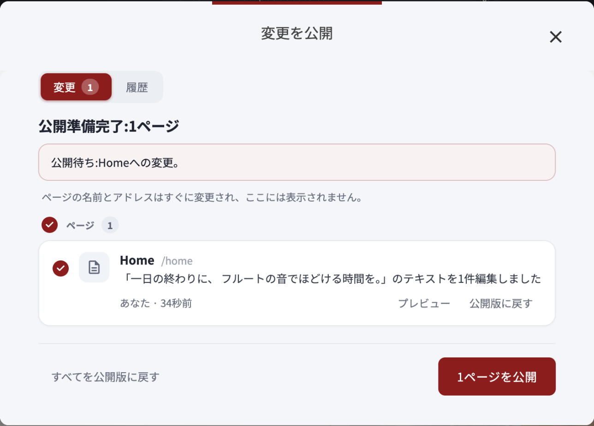

# 変更を公開する（公開ボタン）

ビルダーで「**保存**」を押しても、外から見えるページはまだ変わりません。保存した変更は、いったん下書きとして残ります。外に出すには、右上の公開ボタンから「**公開**」を押します。


**2026年11月に仕組みが変わりました。** それまでは、保存した時点で外のページにも反映されていました。いまは「保存」と「公開」が別の操作です。ヘルプの動画などで「保存すれば外から見える」と話している所は、保存のあとに公開まで進めてください。


## 公開ボタンの場所と見方

ビルダーの上のバーの右側にある、上向きの矢印のマークが公開ボタンです。

- **緑の点が付いているとき**: 公開していない変更があります。マウスを乗せると「未公開の変更○件 — クリックして確認・公開」と出ます。
- **点が無いとき**: 外のページは最新です。マウスを乗せると「最新です — 最終公開：日時」と出ます。

## 公開する手順

1. ページを直して、上のバーの緑の「**保存**」を押します。
2. 右上の公開ボタン（上向きの矢印）を押します。
3. 「**変更を公開**」の窓が開きます。公開していない変更が、ページごとに並びます。何が変わったか、誰がいつ変えたかも出ます。
4. 窓の下の「**○ページを公開**」を押します。数秒で外のページに反映されます。

<figure><figcaption>「変更を公開」の窓。公開していない変更が、ページごとに並びます</figcaption></figure>

最後に、外のページを開いて、変わっているかを確かめてください。

## 窓でできること

- **プレビュー**: 公開する前に、変更後の見た目を確かめます。
- **公開版に戻す**: そのページの下書きを捨てて、いま外に出ている形に戻します。
- **すべてを公開版に戻す**: 前回の公開のあとに作った下書きを、まとめて捨てます。
- **履歴**: 窓の上の「**履歴**」で、これまでの公開の一覧を見られます。ヘッダー・フッター・グローバルスタイルなどは、ページとは別に以前の版へ戻せます。

## 公開が必要なもの、すぐ変わるもの

| 公開ボタンで公開するもの | 保存した時点で変わるもの |
|---|---|
| ページの中身（文・写真・パーツ） | ページの名前 |
| ページ設定・SEO | ページのアドレス（URL） |
| ヘッダー・フッター・グローバルスタイル | |
| ファネルのページ | |


新しく作ったサイトは、テンプレートの中身が最初から外に見えています。そこから先に直した所が、公開するまで下書きになります。


## AI に直してもらったときも同じ

AI アシスタントや外の AI に直してもらった変更も、下書きになります。窓の行には「AI」と出ます。中身をプレビューで確かめてから公開してください。AI に頼むときの決まりは「[AI に操作を手伝ってもらう](work-with-ai.md)」にあります。

## うまくいかないとき

| 困っていること | 確かめること |
|---|---|
| 保存したのに、外のページが変わらない | 右上の公開ボタンに緑の点が付いていないか。付いていれば、押して「公開」 |
| 外のページを開いても、置いたパーツが出てこない | 同じく公開しているか。公開した直後なら、ページを再読み込み |
| 公開したくない変更まで並んでいる | その行の「公開版に戻す」で、その下書きを捨てる |
