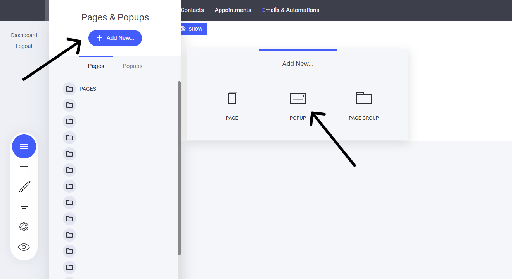
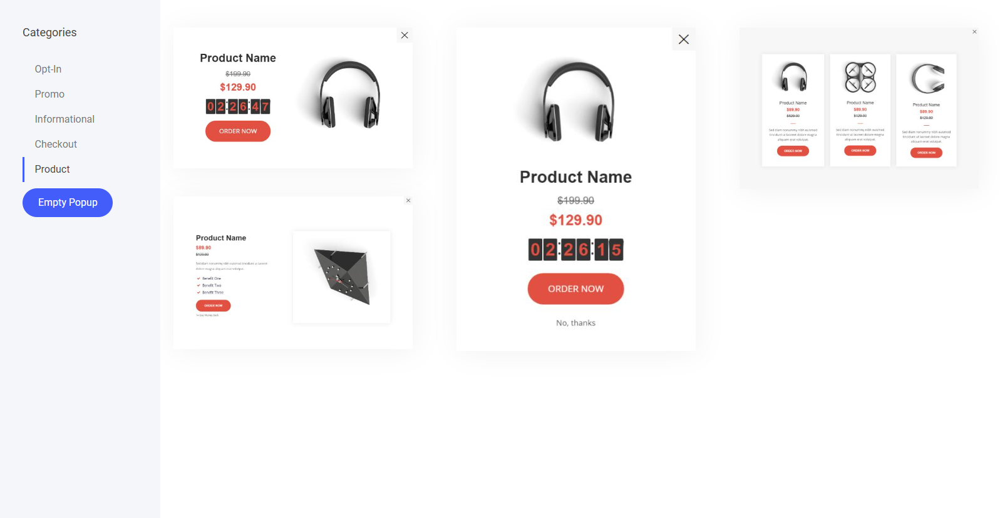
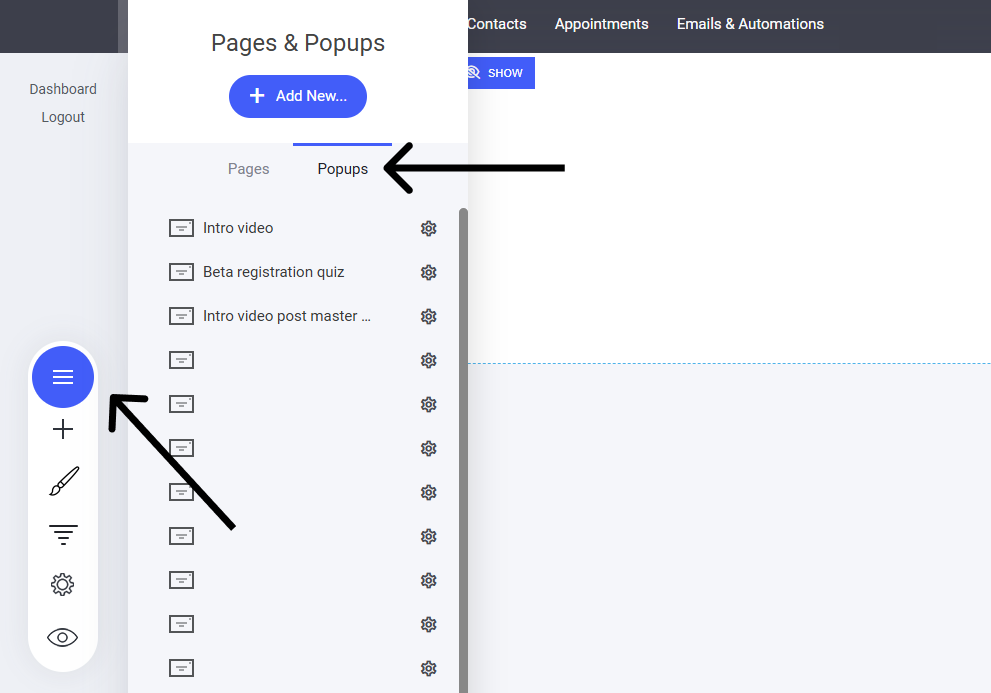
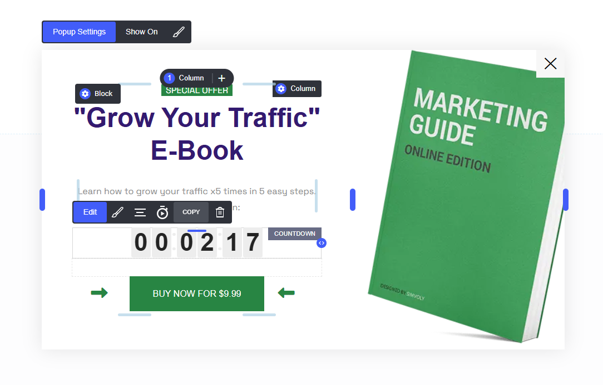
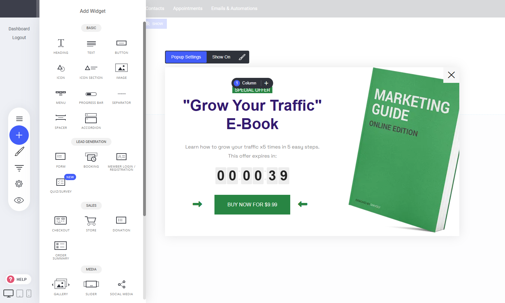
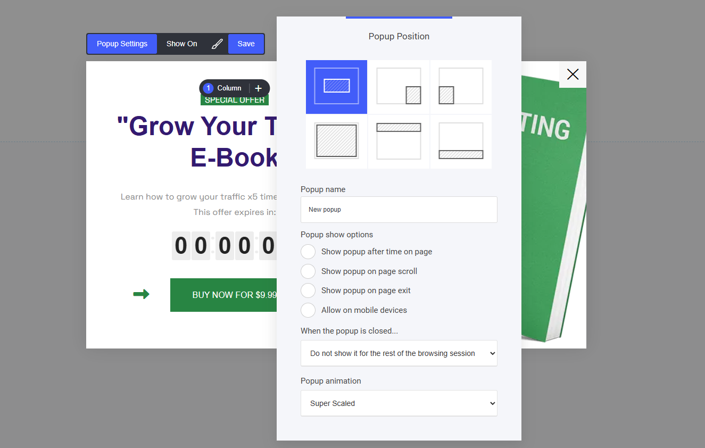
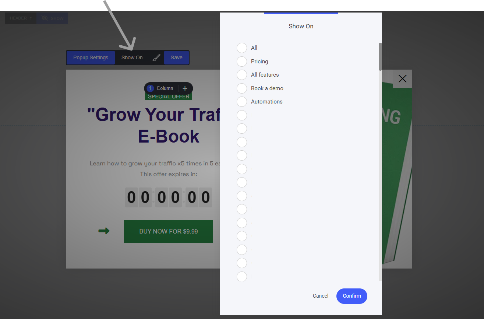
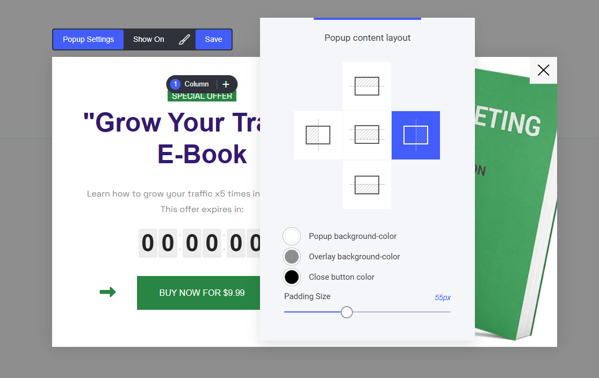

# ポップアップ

**ポップアップを作成、デザイン、構築する方法**

このガイドでは、以下のことを学びます。

* 新しいポップアップの作成方法
* 作成したポップアップの保存場所
* ポップアップビルダー：ポップアップのデザインと編集方法
* ポップアップの設定:ポップアップの位置、名前、その他の表示オプションの変更/調整方法
* ポップアップを表示または表示させるページの選択方法

### 新しいポップアップの作成方法

新しいポップアップを作成するには、ビルダー画面を開き、**\[ページ] -> \[新しく追加する] -> \[ポップアップ]** に移動します。

編集可能な既製のポップアップを選択するか、または「空のポップアップ」を選択して、ゼロから作成することができます。

### 作成したポップアップの保存場所

作成したポップアップを見つけるには、**\[ページ] -> \[ポップアップ]** に移動します。

### ポップアップビルダー：ポップアップのデザインと編集方法

ポップアップビルダーは、通常のページビルダーとまったく同じ外観で動作します。

[ウィジェット](../widgets/)の種類に関係なく、ポップアップインターフェースにドラッグ＆ドロップすることができます。ポップアップに移動した後も、ウィジェットのすべての機能が動作し、標準のページビルダー環境内と同様に、変更、再配置、カスタマイズが可能です。

これにより、シームレスで多様な編集体験が可能になり、機能上の制限や妥協をすることなく、あなたはコンテンツを最適化し、パーソナライズする柔軟性を手に入れることができます。

### ポップアップの設定:ポップアップの位置、名前、その他の表示オプションの変更/調整方法

ポップアップの一般設定にアクセスするには、ポップアップ名の隣にあ&#x308B;**「歯車アイコン」**&#x3092;クリックし&#x3066;**「設定を表示」**&#x3092;選択するか、ポップアップ名をクリックしてポップアップを開&#x304D;**、「ポップアップ設定」**&#x3092;選択します。

ポップアップ設定では、ポップアップで利用可能な6つのレイアウトが表示されます。お好みのものをお選びください。

以下についても。

* ポップアップの名前（リンクを貼っておくと、ポップアップを見つけやすくなります）
* ポップアップの表示オプション（ボタン/リンクをクリックしてもポップアップが表示されない場合）
* どのくらいの頻度でポップアップを表示させるか
* ポップアップ表示時のアニメーション

### ポップアップを表示するページを選択する方法

ポップアップが自動的にトリガーされる場合は、どのページに表示するかを選択できます。

ウェブサイトのどのページにポップアップを表示するかを選択するには、ポップアップを開い&#x3066;**「表示する」**&#x30AA;プションを選択します。ここで、ポップアップを表示するページを選択できます。

ポップアップ コンテンツとレイアウトのスタイルを設定するには、ポップアップ名をクリックして開きます。

次に、ブラシの「スタイル」アイコンをクリックします。

これで、ポップアップ コンテンツ レイアウト設定ボックスが開きます。

ポップアップ コンテンツ レイアウトには、画像を表示する場所のオプションが表示されます。中央のオプションを選択すると、画像は表示されません。

**以下の調整も可能です。**

* ポップアップ全体の背景色
* ポップアップ全体の下にある背景オーバーレイの色
* 閉じるボタンの色
* ポップアップウィンドウのパディング（余白）

---

<!-- cta:opusbooster -->

**自分の場合はどう使えばいいか**

[OpusBoosterの機能全体](https://opusbooster.com/all-features)を見る。設計から相談したい方は[15分の無料相談](https://opusbooster.com/consultation)、まず触ってみたい方は[14日間の無料トライアル](https://opusbooster.com/register)（クレジットカード不要）から。

