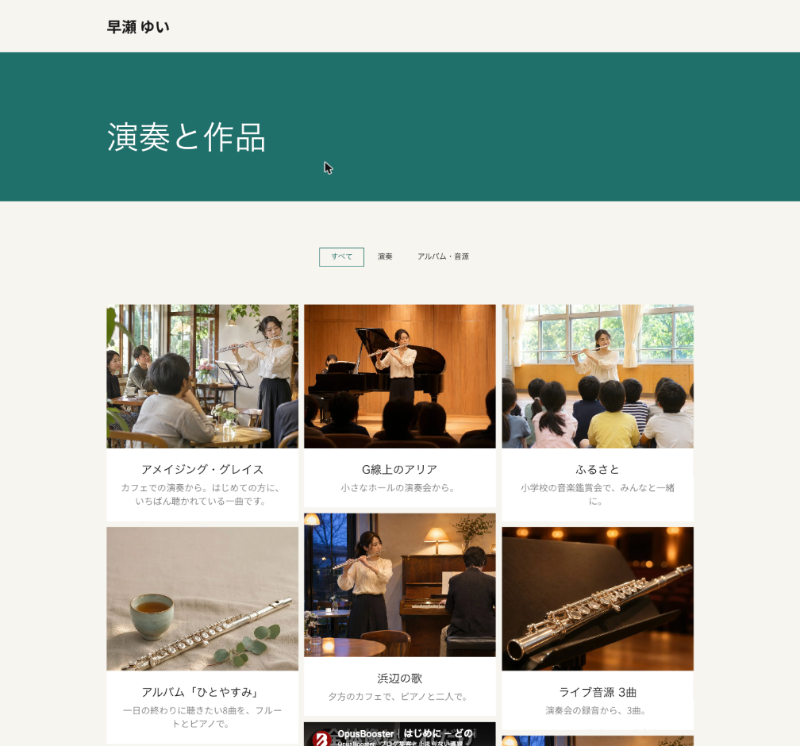
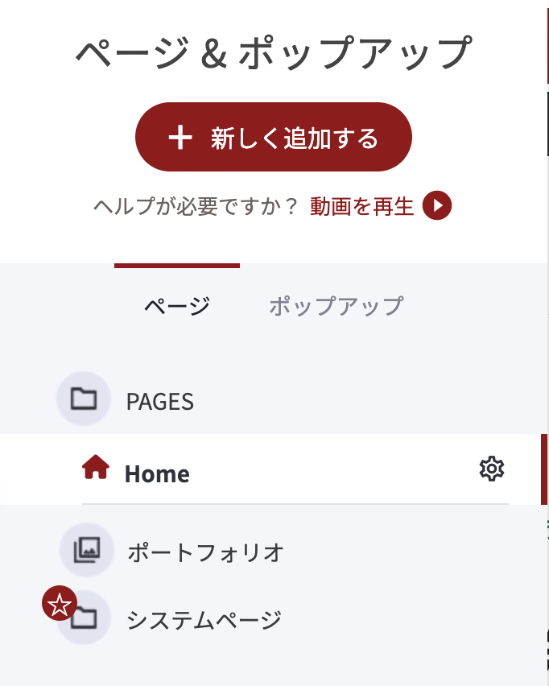
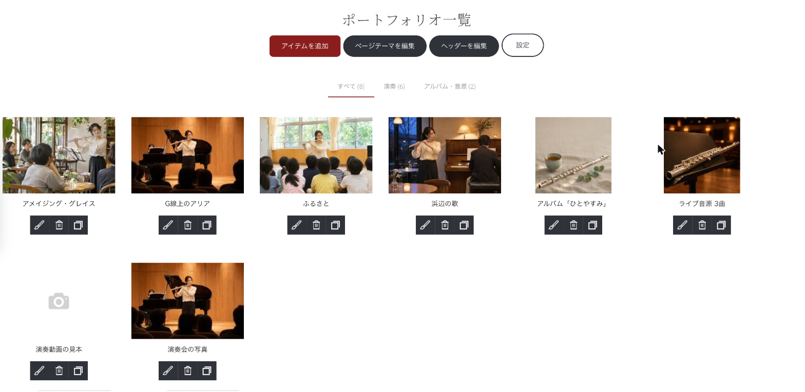
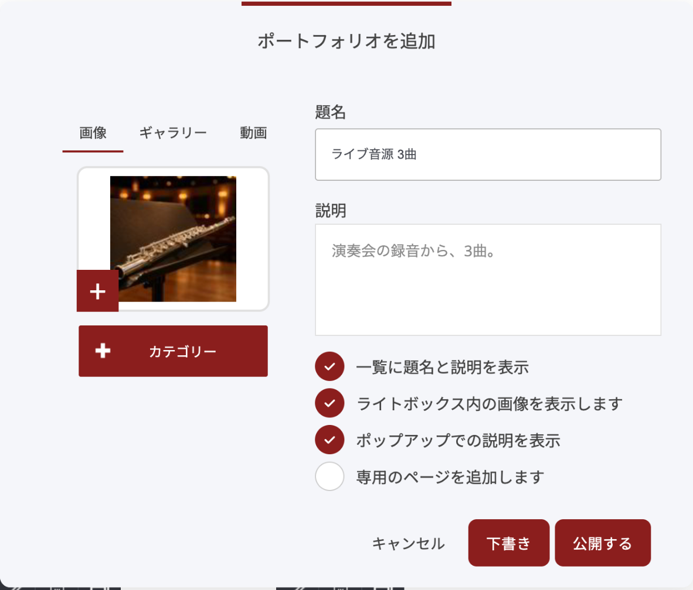
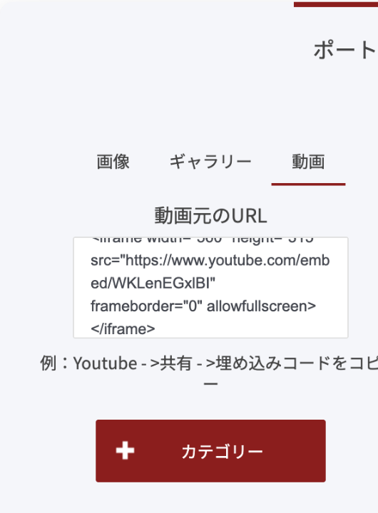
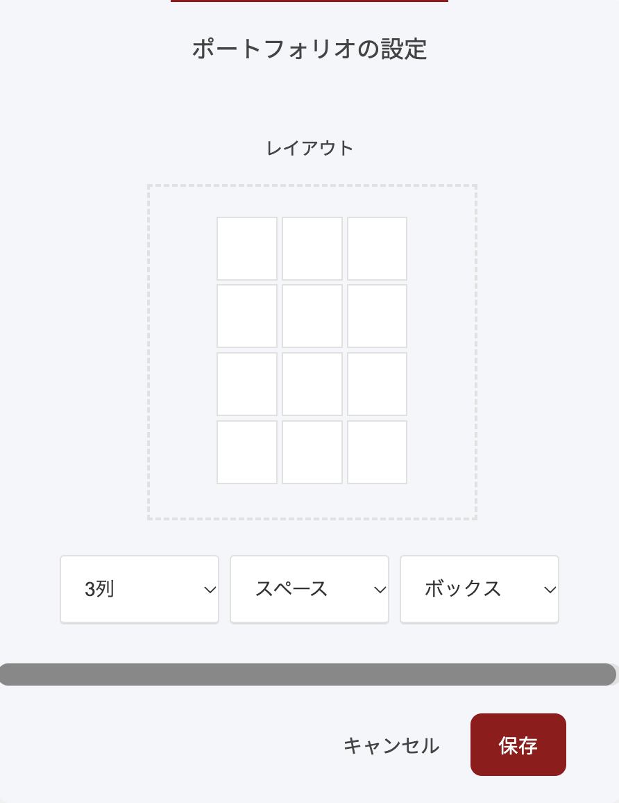
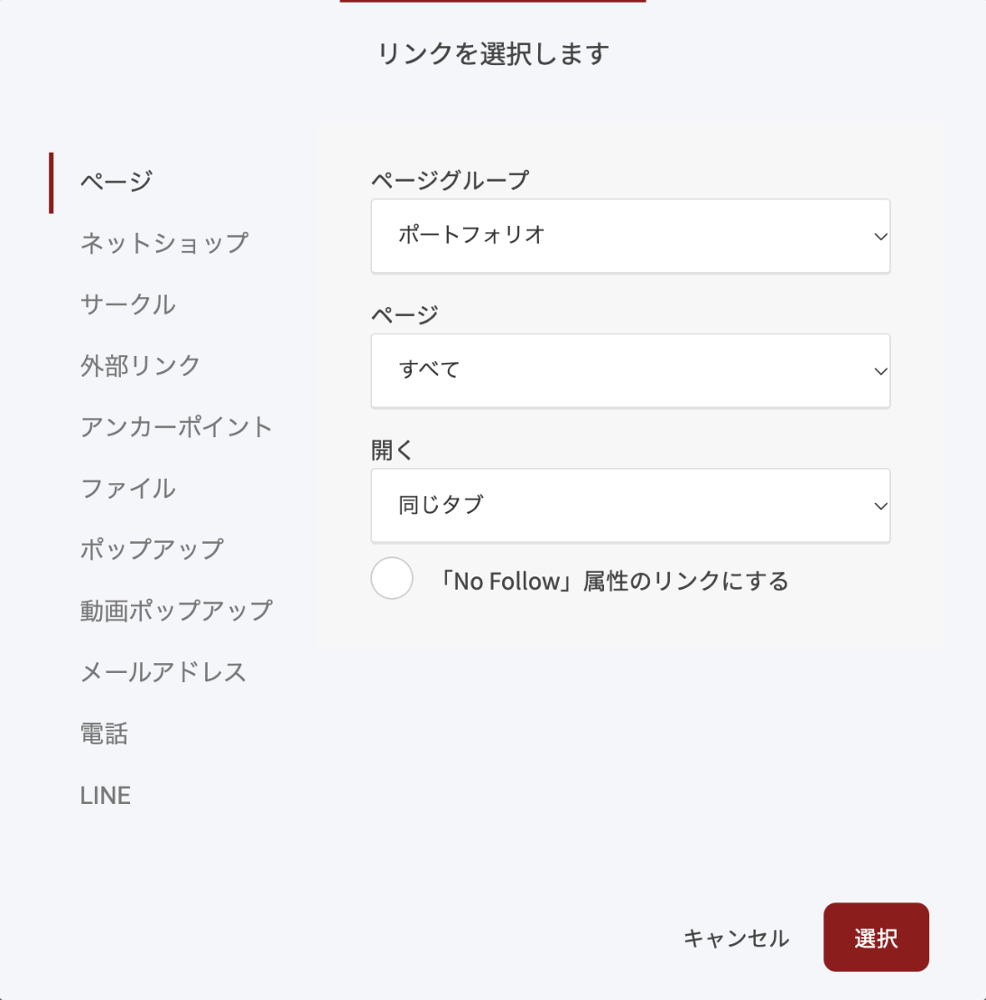

# 演奏や作品を並べる（ポートフォリオ）

演奏動画、演奏会の写真、アルバム。あなたの「聴いてほしい・見てほしいもの」を1か所に並べるのが、ポートフォリオです。作品を1件ずつ登録するだけで、一覧のページができます。種類ごとの絞り込みもできます。

<figure><figcaption>
ポートフォリオの一覧ページの例。作品が並び、上の種類の名前で絞り込めます。
</figcaption></figure>

## できること

- 写真か動画を1件ずつ登録して、一覧に並べる
- 「演奏」「アルバム」のように、種類（カテゴリー）で絞り込めるようにする
- 一覧を、サイトのメニューに出す
- 選んだ作品だけを、ほかのページに並べる

ポートフォリオは、1つのサイトに1つです。

## 1. ポートフォリオを開く

編集画面の左側にある、3本線のアイコンを押して「ページ & ポップアップ」を開きます。

- 一覧に「**ポートフォリオ**」があるときは、それを押します。
- 無いときは、「**新しく追加する**」を押し、「**ポートフォリオ**」を選びます。

<figure><figcaption>
「ページ & ポップアップ」の一覧にある「ポートフォリオ」。
</figcaption></figure>

「ポートフォリオ一覧」の画面が開きます。作品を足す、直す、並べ方を変える、はすべてこの画面から行います。

<figure><figcaption>
「ポートフォリオ一覧」の画面。上のボタンから、作品の追加・帯の編集・並べ方の設定ができます。
</figcaption></figure>

### 最初に入っている見本について

**自己紹介ページやファネルハブのテンプレートから始めた方**は、日本語の見本が6件、下書きの状態で入っています。下書きの作品は、あなたの管理画面にだけ出て、来た人には見えません。

1. 見本の下の鉛筆のアイコンを押します。
2. 写真・題名・説明を、あなたのものに差し替えます。
3. 「**公開する**」を押すと、一覧に並びます。

使わない見本は、ごみ箱のアイコンで消してください。

**そのほかの方**は、英語の見本が8件入っています。ごみ箱のアイコンで、1件ずつ消してください。全部消すと、英語の種類（Nature など）も一緒に消えます。

## 2. 作品を足す

1. 「**アイテムを追加**」を押します。「ポートフォリオを追加」の窓が開きます。
2. 左側で、見せるものを選びます。
   - **画像**: 写真を1枚。赤い「＋」を押して、写真を選びます。
   - **ギャラリー**: 写真を何枚か。一覧では写真が順に入れ替わり、拡大すると1枚ずつ見られます。
   - **動画**: YouTube などの動画。入れ方は次の節で説明します。
3. 右側の「**題名**」と「**説明**」を入れます。説明は、1行で十分です。
4. 「**カテゴリー**」を押して、種類を選びます。新しい種類は、名前を入れて「＋」を押すと作れます。
5. 「**公開する**」を押します。すぐに一覧に並びます。

<figure><figcaption>
「ポートフォリオを追加」の窓。左で写真か動画を選び、右に題名と説明を入れます。
</figcaption></figure>

まだ見せたくないときは、「公開する」の代わりに「**下書き**」を押します。

背景が暗い色のサイトでは、一覧の題名が薄くて読みにくくなることがあります。そのときは、同じ窓の「**一覧に題名と説明を表示**」のチェックを外してください。一覧には写真だけが並び、題名と説明は、写真にマウスを乗せて「i」のボタンを押すと読めます。


**「専用のページを追加します」は、オフのままで大丈夫です**

オンにすると、作品ごとに1ページずつ、別のページが作られます。そのページは、見本の文章が入った状態で始まるので、作品ごとに自分で書き換える必要があります。はじめは、オフのまま使うのがおすすめです。


## 3. 演奏動画を入れる

動画は、アドレスではなく「埋め込みコード」を入れます。

1. YouTube で、入れたい動画を開きます。
2. 動画の下の「**共有**」を押し、「**埋め込む**」を選びます。
3. 表示されたコード（`<iframe` で始まる文字）の右下の「**コピー**」を押します。
4. ポートフォリオの「アイテムを追加」→「**動画**」を選び、「**動画元のURL**」の欄に、コピーしたコードをそのまま貼り付けます。
5. 題名・説明・カテゴリーを入れて、「**公開する**」を押します。

<figure><figcaption>
「動画」を選び、「動画元のURL」の欄に埋め込みコードを貼ります。
</figcaption></figure>

一覧に、動画の画面が並びます。来た人は、作品にマウスを乗せて拡大のボタンを押すと、その場で再生できます。


**動画のアドレスをそのまま貼ると、文字のまま表示されます**

`https://youtu.be/…` のようなアドレスを貼ると、動画にならず、アドレスの文字がそのまま一覧に出ます。必ず「共有」→「埋め込む」のコードを貼ってください。


1件の作品に入れられるのは、写真か動画のどちらかです。両方を入れると、動画だけが表示されます。

## 4. 一覧を整える

### 上の帯の見出しを変える

一覧のいちばん上の帯には、見出しが入っています。

1. 「ポートフォリオ一覧」の画面で、「**ヘッダーを編集**」を押します。
2. 帯の見出しをダブルクリックして、「演奏と作品」のように、あなたの言葉に書き換えます。
3. 「**保存**」を押します。右にパネルが開いているときは、1回目でパネルが閉じます。もう1回押してください。

「ヘッダーを編集」という名前ですが、サイトの上のメニューではなく、この一覧の帯を直す画面です。

### 並べ方を変える

1. 「**設定**」を押します。「ポートフォリオの設定」の窓が開きます。
2. 列の数を選びます（リスト／2列／3列／4列／5列／グリッド配置）。作品が少ないうちは、3列が見やすいです。
3. 「**保存**」を押します。

<figure><figcaption>
「ポートフォリオの設定」の窓。列の数を選びます。
</figcaption></figure>

管理画面の一覧の並びは、設定を変えても変わりません。来た人に見える並びは、公開ページで確かめてください。

### 作品を直す・隠す

作品の下の鉛筆のアイコンで、内容を直せます。一覧から外したいときは、鉛筆 →「**下書き**」を押します。もう一度見せたいときは、鉛筆 →「**公開する**」を押すと、元の位置に戻ります。

## 5. メニューに出す

一覧のページは、自動ではメニューに入りません。ヘッダーにメニューがまだ無いときは、先に [自己紹介ページから始めて、サイトを育てる](https://docs.opusbooster.com/platform/getting-started/grow-from-first-page) の「足したページを、上のメニューに出す」の手順で、メニューを置いてください。

1. ページの編集画面で、ヘッダーのメニューをクリックします。
2. メニューの上に出る、メニューの名前（赤い文字）を押し、「**メニュー項目を追加する**」を押します。
3. 「リンクを選択します」の窓で「**ページ**」を選び、「**ページグループ**」を「**ポートフォリオ**」に変えます。
4. 「ページ」が「**すべて**」になっているのを確かめて、「**選択**」を押します。「すべて」が、一覧のページです。
5. できた項目を押して、名前を「演奏と作品」のように書き換えます。
6. ページの本文をクリックしてパネルを閉じ、上のバーの緑の「**保存**」を押します。「更新しました」と出れば、保存できています。

<figure><figcaption>
「リンクを選択します」の窓。ページグループを「ポートフォリオ」に、ページを「すべて」にします。
</figcaption></figure>

## 6. ほかのページに、作品を並べる

最初のページやプロフィールのページに、選んだ作品だけを並べることもできます。

1. 並べたいページの編集画面で、「ウィジェットを追加」→「その他」→「**ポートフォリオ**」を置きます。
2. 右のパネルの「**アイテムの追加**」を押し、並べたい作品にチェックを入れて「**選択**」を押します。
3. 「レイアウト」で、「グリッド」（並べる）か「カルーセル」（横に送る）を選びます。
4. 上のバーの「**保存**」を押します。

## うまくいかないとき

| 困ったこと | 確かめる所 |
| --- | --- |
| 動画が、アドレスの文字のまま出る | アドレスではなく、「共有」→「埋め込む」のコードを貼る |
| 動画が、一覧の上では再生できない | 作品にマウスを乗せて、拡大のボタンを押す。開いた窓の中で再生できる |
| 写真を入れたのに、動画しか出ない | 1件に入れられるのは、写真か動画のどちらか。写真は別の作品として足す |
| 一覧に題名が出ない | 作品の編集で「一覧に題名と説明を表示」にチェックを入れる |
| 暗い色のサイトで、一覧の題名が読めない | 作品の編集で「一覧に題名と説明を表示」のチェックを外す。一覧は写真だけになり、題名と説明は、写真にマウスを乗せて「i」のボタンを押すと読める |
| 作品が一覧に出ない | 「下書き」のままになっていないか。鉛筆 →「公開する」 |
| 絞り込みに、作った種類が出ない | その種類の作品が、1件も公開されていない。作品を公開すると出る |

***


**自分の場合はどう使えばいいか**

[OpusBoosterの機能全体](https://opusbooster.com/features)を見る。設計から相談したい方は[15分の無料相談](https://opusbooster.com/consultation)、まず触ってみたい方は[14日間の無料トライアル](https://opusbooster.com/register)（クレジットカード不要）から。

